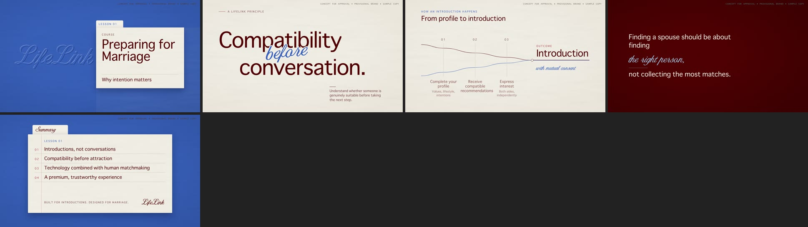

# Storyboard — LifeLink brand concepts v1

Lesson `concepts-v1` · 0:57.0 · 5 scenes · 5 sections · 16:9

_No creative-plan.md yet._

## Scenes

### 1. c1 · courseIntro · 0:00.0–0:11.0 (11.0s)

**On screen:** Course / Preparing for Marriage / Lesson 01 / Why intention matters  
**Narration:** _(no transcript)_

### 2. c2 · statementCollision · 0:11.0–0:22.0 (11.0s)

**On screen:** A LifeLink principle / Compatibility / before / conversation. / Understand whether someone is genuinely suitable before taking the next step.  
**Narration:** _(no transcript)_

### 3. c3 · introductionPath · 0:22.0–0:35.0 (13.0s)

**On screen:** How an introduction happens / From profile to introduction / Complete your profile / Values, lifestyle, intentions / Receive compatible recommendations / Express interest / Both sides, independently / Introduction / with mutual consent  
**Narration:** _(no transcript)_

### 4. c4 · reflectionField · 0:35.0–0:46.0 (11.0s)

**On screen:** Finding a spouse should be about finding / the right person, / not collecting the most matches. / oxblood  
**Narration:** _(no transcript)_

### 5. c5 · summaryLedger · 0:46.0–0:57.0 (11.0s)

**On screen:** Summary / Lesson 01 / Introductions, not conversations / Compatibility before attraction / Technology combined with human matchmaking / A premium, trustworthy experience / Built for introductions. Designed for marriage.  
**Narration:** _(no transcript)_
