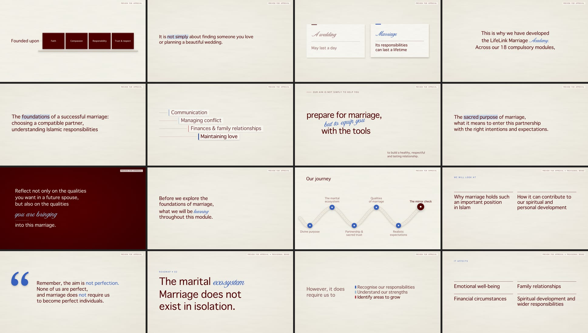

# Storyboard — Module 01: The sacred purpose of marriage

Lesson `lifelink-course-L01` · 36:08.3 · 149 scenes · 16 sections · 16:9

## Creative plan: Module 01, opening (0:00–0:40.7), preview for approval

**Tone:** warm welcome → quiet significance → inclusive → the academy's core belief.

| Scene | Time | Narration (transcript) | Treatment | Why |
|---|---|---|---|---|
| s001 | 0.0–7.6 | "Assalamu Alaikum, welcome to LifeLink Marriage Academy brought to you by Educating Excellence Group." | Course intro (The Folder) | Opening of the whole academy; brand moment |
| s002 | 7.6–16.4 | "…this important first step towards preparing for one of the most significant relationships of your life." | Reflection on royal blue | The weight of the decision; stillness, not spectacle |
| s003 | 16.4–29.0 | "Whether you are considering marriage for the first time, have previously been married or are now exploring the possibility of remarriage, this programme has been developed to support you." | Equal Columns (new) | Three kinds of learner shown as equals: no numbers, no ranking, no dimming |
| s004 | 29.0–40.7 | "At LifeLink we believe that finding the right life partner is important, however we also believe that becoming the right life partner is equally important." | Key statement, script emphasis on *Becoming*, *equally* | The academy's central idea: the shift from finding to becoming |

**Flags for the client:**
- "Educating Excellence Group" is spoken but not shown on screen. Should it appear (e.g. on the intro card)?
- Module title "The sacred purpose of marriage" is taken from the narration at ~2:05 ("In this first module, we will explore the sacred purpose of marriage").
- Transcription needs checking later in the lesson (not in this preview): "Smillah" → Bismillah? "Surah Arghum" → Surah Ar-Rum (30:21)? "a manner of sacred trust" → "an amanah, a sacred trust"?

## Creative plan: Module 01, extension (0:40.7–1:00), preview for approval

**Tone:** the reframe ("not simply… it is about…") → the faith's definition. Text-only throughout: the narration offers nothing meaningful to picture, so no illustration or decorative motion (client rule).

| Scene | Time | Narration (transcript) | Treatment | Why |
|---|---|---|---|---|
| s005 | 40.7–45.1 | "Marriage is not simply about finding someone who meets a list of expectations," | Statement, plain ink type on paper, each line rises as spoken | The "not this" half of the reframe: no script, no object, so the list gets no visual weight; cut sits in the pause after "expectations" |
| s006 | 45.1–54.4 | "it is about developing the knowledge, emotional maturity, understanding and character needed to build a successful relationship." | Equal Columns (as s003), four qualities, closing in script | The "but this" half: four qualities as unranked equals, each appearing on its word; the outcome lands in royal script |
| s007 | 54.4–60.0 | "In Islam, marriage, or nikah, is a sacred covenant." | Still, centred definition card; script emphasis on *sacred covenant* | The faith's definition; nothing to picture, so a clean text card that holds still once complete. Emphasis on the meaning, not on the uncertain term |

**Flags for the client:**
- Spelling of "nikah" (spoken 56.9–57.4 s; transcription confidence 0.51, not yet listened to): please confirm the house spelling (nikah / nikkah / nikāḥ). Shown in plain type until confirmed.
- Display punctuation: "expectations," is shown as "expectations." because the sentence is split across s005/s006; "the" before "knowledge" is dropped so the four qualities read in parallel. No other words changed.

## Scenes

### 8. sec-03-01 · foundationLayers · 1:00.0–1:08.9 (8.9s)

**On screen:** Founded upon / Faith / Compassion / Responsibility / Trust & respect  
**Narration:** It is a commitment founded upon faith, compassion, responsibility, trust and mutual respect.

### 9. sec-03-02 · highlightLine · 1:08.9–1:14.1 (5.2s)

**On screen:** It is not simply about finding someone you love / or planning a beautiful wedding. / not simply / sky  
**Narration:** It is not simply about finding someone you love or planning a beautiful wedding.

### 10. sec-03-03 · comparison · 1:14.1–1:20.0 (5.9s)

**On screen:** A wedding / May last a day / Marriage / Its responsibilities can last a lifetime  
**Narration:** A wedding may last a day, but the responsibilities of marriage can last a lifetime.

### 11. sec-03-04 · kineticStatement · 1:20.0–1:27.6 (7.6s)

**On screen:** This is why we have developed / the LifeLink Marriage Academy. / Across our 18 compulsory modules, / Academy / ink  
**Narration:** This is why we have developed the LifeLink Marriage Academy. Across our 18 compulsory modules,

### 12. sec-03-05 · highlightLine · 1:27.6–1:35.8 (8.2s)

**On screen:** The foundations of a successful marriage: / choosing a compatible partner, / understanding Islamic responsibilities / foundations / sky  
**Narration:** we will explore the foundations of a successful marriage, from choosing a compatible partner and understanding Islamic responsibilities to

### 13. sec-03-06 · wordStack · 1:35.8–1:42.8 (7.0s)

**On screen:** Communication / Managing conflict / Finances & family relationships / Maintaining love / offset  
**Narration:** communication, managing conflict, finances, family relationships and maintaining love.

### 14. sec-03-07 · statementCollision · 1:42.8–1:52.3 (9.5s)

**On screen:** Our aim is not simply to help you / prepare for marriage, / but to equip you / with the tools / to build a healthy, respectful and lasting relationship.  
**Narration:** Our aim is not simply to help you prepare for marriage, but to equip you with the tools to build a healthy, respectful and lasting relationship.

### 15. sec-03-08 · highlightLine · 1:52.3–2:02.9 (10.6s)

**On screen:** The sacred purpose of marriage, / what it means to enter this partnership / with the right intentions and expectations. / sacred purpose / royal  
**Narration:** In this first module, we will explore the sacred purpose of marriage and what it means to enter this partnership with the right intentions and expectations.

### 16. sec-03-09 · reflectionField · 2:02.9–2:15.9 (13.0s)

**On screen:** Reflect not only on the qualities / you want in a future spouse, / but also on the qualities / you are bringing / into this marriage. / oxblood  
**Narration:** As you listen, I encourage you to reflect not only on the qualities you want in a future spouse, but also on the qualities you are bringing into this marriage. Let us begin, Smillah.

### 17. sec-03-10 · kineticStatement · 2:15.9–2:24.1 (8.2s)

**On screen:** Before we explore the foundations of marriage, / what we will be learning throughout this module. / learning / ink  
**Narration:** Before we explore the foundations of marriage, I would like to explain what we will be learning throughout this module.

### 18. sec-03-11 · lessonMap · 2:24.1–4:04.0 (99.9s)

**On screen:** Our journey / Divine purpose / The marital ecosystem / Partnership & sacred trust / Qualities of marriage / Realistic expectations / The mirror check / An important position in Islam / Spiritual & personal development / Marriage does not exist in isolation / Emotional well-being, family / Finances, spiritual development / Wider responsibilities / What does it mean to share your life? / Balance our needs with someone else's / External qualities / Appearance, education, employment / Family background, financial stability / We must also look at character / Kindness, honesty / Emotional maturity, communication / Relationships experience difficulties / Assumptions never discussed / Look inward, reflect on our readiness  
**Narration:** Our journey begins with understanding the divine purpose of marriage. We will look at why marriage holds such an important position in Islam and how it can contribute to our spiritual and personal development. We will then explore what I call the marital ecosystem. Marriage does not exist in isolation. It affects our emotional well -being, family relationships, financial circumstances, spiritual development and wider responsibilities. Next, we will consider the concept of partnership and a manner of sacred trust. What does it actually mean to share your life with another individual? How do we balance our own needs and ambitions with the needs of someone else? We will also examine the qualities of a successful marriage. Often when people are searching for a spouse, they focus on external qualities such as appearance, education, employment, family background or financial stability. Although some of these considerations may be important, we must also look at the emotional maturity and the ability to communicate. We will then explore realistic expectations. Many relationships experience difficulties because individuals enter marriage with assumptions that have never been discussed. Finally, we will complete what we call the mirror check. This is an opportunity to look inward and reflect on our own readiness for marriage. Throughout this module,

### 19. sec-03-20 · pullQuote · 4:04.0–4:13.9 (9.9s)

**On screen:** Remember, the aim is not perfection. / None of us are perfect, / and marriage does not require us / to become perfect individuals. / not perfection.  
**Narration:** remember that the aim is not perfection. None of us are perfect and marriage does not require us to become perfect individuals.

### 20. sec-03-21 · wordStack · 4:13.9–4:24.0 (10.1s)

**On screen:** However, it does require us to / Recognise our responsibilities / Understand our strengths / Identify areas to grow / column  
**Narration:** However, it does require us to recognise our responsibilities, understand our strengths and identify areas in which we need to grow.
