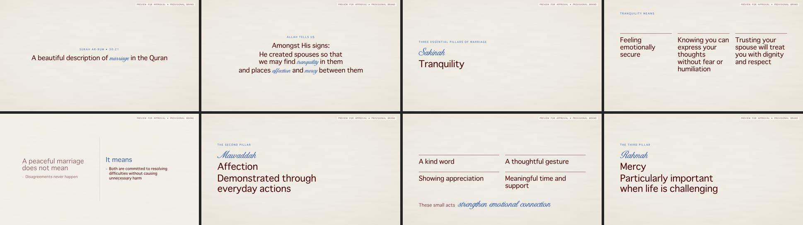

# Storyboard — Module 01: The sacred purpose of marriage

Lesson `lifelink-course-L01` · 36:08.3 · 149 scenes · 16 sections · 16:9

## Creative plan: Module 01, opening (0:00–0:40.7), preview for approval

**Tone:** warm welcome → quiet significance → inclusive → the academy's core belief.

| Scene | Time | Narration (transcript) | Treatment | Why |
|---|---|---|---|---|
| s001 | 0.0–7.6 | "Assalamu Alaikum, welcome to LifeLink Marriage Academy brought to you by Educating Excellence Group." | Course intro (The Folder) | Opening of the whole academy; brand moment |
| s002 | 7.6–16.4 | "…this important first step towards preparing for one of the most significant relationships of your life." | Reflection on royal blue | The weight of the decision; stillness, not spectacle |
| s003 | 16.4–29.0 | "Whether you are considering marriage for the first time, have previously been married or are now exploring the possibility of remarriage, this programme has been developed to support you." | Equal Columns (new) | Three kinds of learner shown as equals: no numbers, no ranking, no dimming |
| s004 | 29.0–40.7 | "At LifeLink we believe that finding the right life partner is important, however we also believe that becoming the right life partner is equally important." | Key statement, script emphasis on *Becoming*, *equally* | The academy's central idea: the shift from finding to becoming |

**Flags for the client:**
- "Educating Excellence Group" is spoken but not shown on screen. Should it appear (e.g. on the intro card)?
- Module title "The sacred purpose of marriage" is taken from the narration at ~2:05 ("In this first module, we will explore the sacred purpose of marriage").
- Transcription needs checking later in the lesson (not in this preview): "Smillah" → Bismillah? "Surah Arghum" → Surah Ar-Rum (30:21)? "a manner of sacred trust" → "an amanah, a sacred trust"?

## Creative plan: Module 01, extension (0:40.7–1:00), preview for approval

**Tone:** the reframe ("not simply… it is about…") → the faith's definition. Text-only throughout: the narration offers nothing meaningful to picture, so no illustration or decorative motion (client rule).

| Scene | Time | Narration (transcript) | Treatment | Why |
|---|---|---|---|---|
| s005 | 40.7–45.1 | "Marriage is not simply about finding someone who meets a list of expectations," | Statement, plain ink type on paper, each line rises as spoken | The "not this" half of the reframe: no script, no object, so the list gets no visual weight; cut sits in the pause after "expectations" |
| s006 | 45.1–54.4 | "it is about developing the knowledge, emotional maturity, understanding and character needed to build a successful relationship." | Equal Columns (as s003), four qualities, closing in script | The "but this" half: four qualities as unranked equals, each appearing on its word; the outcome lands in royal script |
| s007 | 54.4–60.0 | "In Islam, marriage, or nikah, is a sacred covenant." | Still, centred definition card; script emphasis on *sacred covenant* | The faith's definition; nothing to picture, so a clean text card that holds still once complete. Emphasis on the meaning, not on the uncertain term |

**Flags for the client:**
- Spelling of "nikah" (spoken 56.9–57.4 s; transcription confidence 0.51, not yet listened to): please confirm the house spelling (nikah / nikkah / nikāḥ). Shown in plain type until confirmed.
- Display punctuation: "expectations," is shown as "expectations." because the sentence is split across s005/s006; "the" before "knowledge" is dropped so the four qualities read in parallel. No other words changed.

## Scenes

### 21. sec-04-01 · highlightLine · 4:24.0–4:32.6 (8.6s)

**On screen:** A beautiful description of marriage in the Quran / appears in Surah Ar-Rum, verse 21. / Surah Ar-Rum, verse 21. / sky  
**Narration:** Beautiful descriptions of marriage in the Quran appears in Surah Arghum, verse 21.

### 22. sec-04-02 · pullQuote · 4:32.6–4:44.4 (11.8s)

**On screen:** Amongst His signs is that He created spouses / so that we may find tranquility in them, / and He places affection and mercy between them. / tranquility / affection / mercy / Qur'an 30:21 (translation of meaning) / scripture  
**Narration:** Allah tells us that amongst his signs is that he created spouses so that we may find tranquility in them and that he places affection and mercy between them.

### 23. sec-04-03 · threePillars · 4:44.4–5:56.2 (71.8s)

**On screen:** Sakina / Tranquility / Mawaddah / Affection / Rahmah / Mercy / Three pillars of marriage / Feeling emotionally secure / Expressing thoughts without fear / Treated with dignity and respect / Disagreements still happen / Resolved without unnecessary harm / More than telling them you love them / Demonstrated through everyday actions / A kind word, a thoughtful gesture / Showing appreciation / Meaningful time together / Support after a difficult day / Small acts strengthen connection  
**Narration:** This verse introduces three essential pillars of marriage. The first is sakina, which means tranquility. Think about what tranquility means in a relationship. It means feeling emotionally secure, knowing that you can express your thoughts without fear or humiliation and trusting that your spouse will treat you with dignity and respect. A peaceful marriage does not mean that disagreements never happen. It means that even when difficulties arise, both individuals are committed to resolving them without causing unnecessary harm. The second pillar is mawuddha or affection. Affection is more than simply telling someone that you love them. It is demonstrated through everyday actions. A kind word, a thoughtful gesture, showing appreciation, spending meaningful time together or offering support after a difficult day. These small acts strengthen emotional connection. The third pillar is rahmah, meaning mercy. Mercy becomes particularly important when life is challenging.

### 24. sec-04-09 · kineticStatement · 5:56.2–6:07.6 (11.4s)

**On screen:** When one spouse is tired, unwell, worried or struggling, / compassion and understanding / can make an enormous difference. / compassion / understanding / focus  
**Narration:** There will be times when one spouse is tired, unwell, worried or struggling. During these moments compassion and understanding can make an enormous difference.

### 25. sec-04-10 · quietReflection · 6:07.6–6:16.6 (9.0s)

**On screen:** Our spouse is human, with strengths, weaknesses, emotions and vulnerabilities.  
**Narration:** Marriage requires us to recognise that our spouse is human with strengths, weaknesses, emotions and vulnerabilities.

### 26. sec-04-11 · threePillars · 6:16.6–6:31.0 (14.4s)

**On screen:** Sakina / Tranquility / Mawaddah / Affection / Rahmah / Mercy  
**Narration:** Now consider these three qualities together. Tranquility provides emotional security. If affection builds connection, mercy helps sustain the relationship during difficulty.

### 27. sec-04-12 · questionPrompt · 6:31.0–6:46.0 (15.0s)

**On screen:** When you think about your future marriage, / which of these three qualities / do you already demonstrate well? / And which would you like to develop further? / royal  
**Narration:** Now reflect for a moment. When you think about your future marriage, which of these three qualities do you believe you already demonstrate well? And which would you like to develop further?
