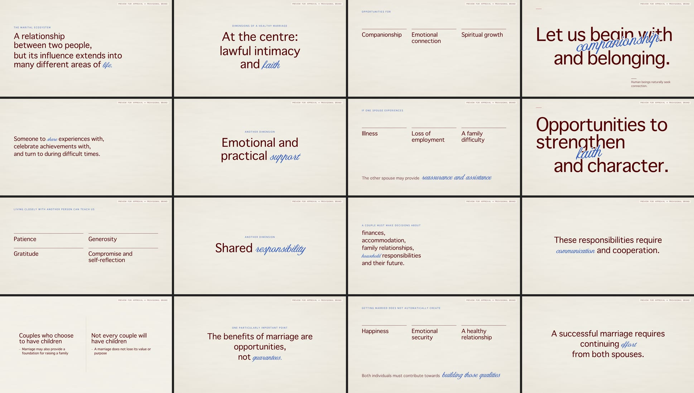

# Storyboard — Module 01: The sacred purpose of marriage

Lesson `lifelink-course-L01` · 36:05.3 · 250 scenes · 16 sections · 16:9

## Creative plan: Module 01, opening (0:00–0:40.7), preview for approval

**Tone:** warm welcome → quiet significance → inclusive → the academy's core belief.

| Scene | Time | Narration (transcript) | Treatment | Why |
|---|---|---|---|---|
| s001 | 0.0–7.6 | "Assalamu Alaikum, welcome to LifeLink Marriage Academy brought to you by Educating Excellence Group." | Course intro (The Folder) | Opening of the whole academy; brand moment |
| s002 | 7.6–16.4 | "…this important first step towards preparing for one of the most significant relationships of your life." | Reflection on royal blue | The weight of the decision; stillness, not spectacle |
| s003 | 16.4–29.0 | "Whether you are considering marriage for the first time, have previously been married or are now exploring the possibility of remarriage, this programme has been developed to support you." | Equal Columns (new) | Three kinds of learner shown as equals: no numbers, no ranking, no dimming |
| s004 | 29.0–40.7 | "At LifeLink we believe that finding the right life partner is important, however we also believe that becoming the right life partner is equally important." | Key statement, script emphasis on *Becoming*, *equally* | The academy's central idea: the shift from finding to becoming |

**Flags for the client:**
- "Educating Excellence Group" is spoken but not shown on screen. Should it appear (e.g. on the intro card)?
- Module title "The sacred purpose of marriage" is taken from the narration at ~2:05 ("In this first module, we will explore the sacred purpose of marriage").
- Transcription needs checking later in the lesson (not in this preview): "Smillah" → Bismillah? "Surah Arghum" → Surah Ar-Rum (30:21)? "a manner of sacred trust" → "an amanah, a sacred trust"?

## Creative plan: Module 01, extension (0:40.7–1:00), preview for approval

**Tone:** the reframe ("not simply… it is about…") → the faith's definition. Text-only throughout: the narration offers nothing meaningful to picture, so no illustration or decorative motion (client rule).

| Scene | Time | Narration (transcript) | Treatment | Why |
|---|---|---|---|---|
| s005 | 40.7–45.1 | "Marriage is not simply about finding someone who meets a list of expectations," | Statement, plain ink type on paper, each line rises as spoken | The "not this" half of the reframe: no script, no object, so the list gets no visual weight; cut sits in the pause after "expectations" |
| s006 | 45.1–54.4 | "it is about developing the knowledge, emotional maturity, understanding and character needed to build a successful relationship." | Equal Columns (as s003), four qualities, closing in script | The "but this" half: four qualities as unranked equals, each appearing on its word; the outcome lands in royal script |
| s007 | 54.4–60.0 | "In Islam, marriage, or nikah, is a sacred covenant." | Still, centred definition card; script emphasis on *sacred covenant* | The faith's definition; nothing to picture, so a clean text card that holds still once complete. Emphasis on the meaning, not on the uncertain term |

**Flags for the client:**
- Spelling of "nikah" (spoken 56.9–57.4 s; transcription confidence 0.51, not yet listened to): please confirm the house spelling (nikah / nikkah / nikāḥ). Shown in plain type until confirmed.
- Display punctuation: "expectations," is shown as "expectations." because the sentence is split across s005/s006; "the" before "knowledge" is dropped so the four qualities read in parallel. No other words changed.

## Scenes

### 46. sec-05-01 · kineticStatement · 6:46.0–6:56.9 (10.9s)

**On screen:** A relationship between two people, / but its influence extends into many different areas of life. / life / The marital ecosystem  
**Narration:** Marriage is often described as a relationship between two people, but its influence extends into many different areas of life.

### 47. sec-05-02 · kineticStatement · 6:56.9–7:11.0 (14.1s)

**On screen:** At the centre: / lawful intimacy and faith / faith / Dimensions of a healthy marriage  
**Narration:** On this slide we can see the different dimensions of a healthy marriage. At the centre is lawful intimacy and faith. Marriage provides an Islamic framework for physical affection and intimacy, but it also

### 48. sec-05-03 · parallelPhrases · 7:11.0–7:17.6 (6.6s)

**On screen:** Opportunities for / Companionship / Emotional connection / Spiritual growth  
**Narration:** provides opportunities for companionship, emotional connection and spiritual growth.

### 49. sec-05-04 · statementCollision · 7:17.6–7:24.8 (7.2s)

**On screen:** Let us begin with / companionship / and belonging. / Human beings naturally seek connection.  
**Narration:** Let us begin with companionship and belonging. Human beings naturally seek connection.

### 50. sec-05-05 · kineticStatement · 7:24.8–7:34.5 (9.7s)

**On screen:** Someone to share experiences with, / celebrate achievements with, / and turn to during difficult times. / share  
**Narration:** Having someone to share experiences with, celebrate achievements with and turning to during difficult times can be a valuable part of married life.

### 51. sec-05-06 · kineticStatement · 7:34.5–7:38.9 (4.4s)

**On screen:** Emotional and practical support / support / Another dimension  
**Narration:** Another important dimension is emotional and practical support.

### 52. sec-05-07 · parallelPhrases · 7:38.9–7:52.3 (13.4s)

**On screen:** If one spouse experiences / Illness / Loss of employment / A family difficulty / The other spouse may provide / reassurance and assistance  
**Narration:** For example, if one spouse experiences illness, loses their employment or faces a family difficulty, the other spouse may be able to provide reassurance and assistance.

### 53. sec-05-08 · kineticStatement · 7:52.3–7:57.4 (5.1s)

**On screen:** Opportunities to strengthen / faith and character. / faith / Marriage also provides  
**Narration:** Marriage also provides opportunities to strengthen faith and character.

### 54. sec-05-09 · parallelPhrases · 7:57.4–8:05.9 (8.5s)

**On screen:** Living closely with another person can teach us / Patience / Generosity / Gratitude / Compromise and self-reflection  
**Narration:** Living closely with another person can teach us patience, generosity, gratitude, compromise and self -reflection.

### 55. sec-05-10a · kineticStatement · 8:05.9–8:10.0 (4.1s)

**On screen:** Shared responsibility / responsibility / Another dimension  
**Narration:** Another dimension is shared responsibility.

### 56. sec-05-10b · kineticStatement · 8:10.0–8:19.3 (9.3s)

**On screen:** finances, / accommodation, / family relationships, / household responsibilities / and their future. / household / A couple must make decisions about  
**Narration:** A couple must make decisions about finances, accommodation, family relationships, household responsibilities and their future.

### 57. sec-05-11 · kineticStatement · 8:19.3–8:24.4 (5.1s)

**On screen:** These responsibilities require / communication and cooperation. / communication  
**Narration:** These responsibilities require communication and cooperation.

### 58. sec-05-12 · comparison · 8:24.4–8:39.4 (15.0s)

**On screen:** Couples who choose to have children / Marriage may also provide a foundation for raising a family / Not every couple will have children / A marriage does not lose its value or purpose  
**Narration:** For couples who choose to have children, marriage may also provide a foundation for raising a family. However, it is important to recognise that not every couple will have children, and a marriage does not lose its value or purpose because of this.

### 59. sec-05-13 · kineticStatement · 8:39.4–8:48.4 (9.0s)

**On screen:** The benefits of marriage are / opportunities, / not guarantees. / guarantees / One particularly important point  
**Narration:** I want to emphasise one particularly important point. The benefit of marriage are opportunities, not guarantees.

### 60. sec-05-14 · parallelPhrases · 8:48.4–9:00.7 (12.3s)

**On screen:** Getting married does not automatically create / Happiness / Emotional security / A healthy relationship / Both individuals must contribute towards / building those qualities  
**Narration:** Simply getting married does not automatically create happiness, emotional security or a healthy relationship. Both individuals must contribute towards building those qualities.

### 61. sec-05-15 · kineticStatement · 9:00.7–9:06.0 (5.3s)

**On screen:** A successful marriage requires / continuing effort / from both spouses. / effort  
**Narration:** A successful marriage requires continuing effort from both spouses.
