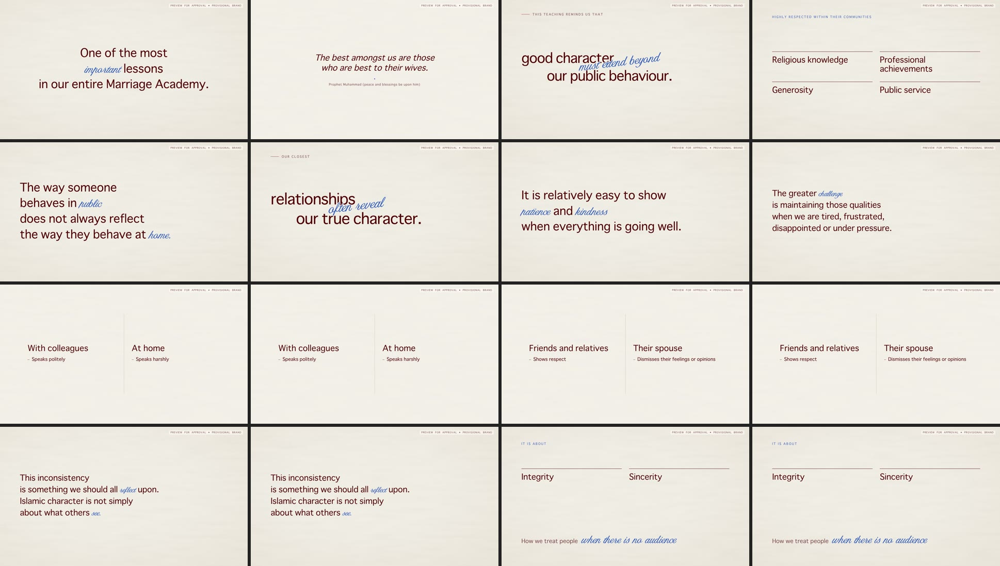

# Storyboard — Module 01: The sacred purpose of marriage

Lesson `lifelink-course-L01` · 36:05.3 · 251 scenes · 16 sections · 16:9

## Creative plan: Module 01, opening (0:00–0:40.7), preview for approval

**Tone:** warm welcome → quiet significance → inclusive → the academy's core belief.

| Scene | Time | Narration (transcript) | Treatment | Why |
|---|---|---|---|---|
| s001 | 0.0–7.6 | "Assalamu Alaikum, welcome to LifeLink Marriage Academy brought to you by Educating Excellence Group." | Course intro (The Folder) | Opening of the whole academy; brand moment |
| s002 | 7.6–16.4 | "…this important first step towards preparing for one of the most significant relationships of your life." | Reflection on royal blue | The weight of the decision; stillness, not spectacle |
| s003 | 16.4–29.0 | "Whether you are considering marriage for the first time, have previously been married or are now exploring the possibility of remarriage, this programme has been developed to support you." | Equal Columns (new) | Three kinds of learner shown as equals: no numbers, no ranking, no dimming |
| s004 | 29.0–40.7 | "At LifeLink we believe that finding the right life partner is important, however we also believe that becoming the right life partner is equally important." | Key statement, script emphasis on *Becoming*, *equally* | The academy's central idea: the shift from finding to becoming |

**Flags for the client:**
- "Educating Excellence Group" is spoken but not shown on screen. Should it appear (e.g. on the intro card)?
- Module title "The sacred purpose of marriage" is taken from the narration at ~2:05 ("In this first module, we will explore the sacred purpose of marriage").
- Transcription needs checking later in the lesson (not in this preview): "Smillah" → Bismillah? "Surah Arghum" → Surah Ar-Rum (30:21)? "a manner of sacred trust" → "an amanah, a sacred trust"?

## Creative plan: Module 01, extension (0:40.7–1:00), preview for approval

**Tone:** the reframe ("not simply… it is about…") → the faith's definition. Text-only throughout: the narration offers nothing meaningful to picture, so no illustration or decorative motion (client rule).

| Scene | Time | Narration (transcript) | Treatment | Why |
|---|---|---|---|---|
| s005 | 40.7–45.1 | "Marriage is not simply about finding someone who meets a list of expectations," | Statement, plain ink type on paper, each line rises as spoken | The "not this" half of the reframe: no script, no object, so the list gets no visual weight; cut sits in the pause after "expectations" |
| s006 | 45.1–54.4 | "it is about developing the knowledge, emotional maturity, understanding and character needed to build a successful relationship." | Equal Columns (as s003), four qualities, closing in script | The "but this" half: four qualities as unranked equals, each appearing on its word; the outcome lands in royal script |
| s007 | 54.4–60.0 | "In Islam, marriage, or nikah, is a sacred covenant." | Still, centred definition card; script emphasis on *sacred covenant* | The faith's definition; nothing to picture, so a clean text card that holds still once complete. Emphasis on the meaning, not on the uncertain term |

**Flags for the client:**
- Spelling of "nikah" (spoken 56.9–57.4 s; transcription confidence 0.51, not yet listened to): please confirm the house spelling (nikah / nikkah / nikāḥ). Shown in plain type until confirmed.
- Display punctuation: "expectations," is shown as "expectations." because the sentence is split across s005/s006; "the" before "knowledge" is dropped so the four qualities read in parallel. No other words changed.

## Scenes

### 62. sec-06-01 · kineticStatement · 9:06.0–9:13.2 (7.2s)

**On screen:** One of the most / important lessons / in our entire Marriage Academy. / important  
**Narration:** This slide introduces one of the most important lessons in our entire marriage academy.

### 63. sec-06-02 · quietReflection · 9:13.2–9:20.9 (7.7s)

**On screen:** The best amongst us are those who are best to their wives. / Prophet Muhammad (peace and blessings be upon him)  
**Narration:** Prophet Muhammad, peace and blessings be upon him, thought that the best amongst us are those who are best to their wives.

### 64. sec-06-03 · statementCollision · 9:20.9–9:26.9 (6.0s)

**On screen:** This teaching reminds us that / good character / must extend beyond / our public behaviour.  
**Narration:** This teaching reminds us that good character must extend beyond our public behaviour.

### 65. sec-06-04 · parallelPhrases · 9:26.9–9:38.6 (11.7s)

**On screen:** Highly respected within their communities / Religious knowledge / Professional achievements / Generosity / Public service  
**Narration:** Sometimes individuals are highly respected within their communities. They may be known for their religious knowledge, professional achievements, generosity or public service.

### 66. sec-06-05 · kineticStatement · 9:38.6–9:44.2 (5.6s)

**On screen:** The way someone / behaves in public / does not always reflect / the way they behave at home. / public / home  
**Narration:** However, the way someone behaves in public does not always reflect the way they behave at home.

### 67. sec-06-06 · statementCollision · 9:44.2–9:49.6 (5.4s)

**On screen:** Our closest / relationships / often reveal / our true character.  
**Narration:** Our closest relationships often reveal our true character.

### 68. sec-06-07 · kineticStatement · 9:49.6–9:54.5 (4.9s)

**On screen:** It is relatively easy to show / patience and kindness / when everything is going well. / patience / kindness  
**Narration:** It is relatively easy to show patience and kindness when everything is going well.

### 69. sec-06-07b · kineticStatement · 9:54.5–10:02.7 (8.2s)

**On screen:** The greater challenge / is maintaining those qualities / when we are tired, frustrated, / disappointed or under pressure. / challenge  
**Narration:** The greater challenge is maintaining those qualities when we are tired, frustrated, disappointed or under pressure.

### 70. sec-06-08 · comparison · 10:02.7–10:11.6 (8.9s)

**On screen:** With colleagues / Speaks politely / At home / Speaks harshly  
**Narration:** Consider this example. Someone may speak politely to colleagues throughout the working day but return home and speak harshly to their spouse.

### 71. sec-06-09 · comparison · 10:11.6–10:17.7 (6.1s)

**On screen:** Friends and relatives / Shows respect / Their spouse / Dismisses their feelings or opinions  
**Narration:** They may show respect to friends and relatives but dismiss their spouse's feelings or opinions.

### 72. sec-06-10 · kineticStatement · 10:17.7–10:26.6 (8.9s)

**On screen:** This inconsistency / is something we should all reflect upon. / Islamic character is not simply / about what others see. / reflect / see  
**Narration:** This inconsistency is something we should all reflect upon. Islamic character is not simply about what others see.

### 73. sec-06-11 · parallelPhrases · 10:26.6–10:32.6 (6.0s)

**On screen:** It is about / Integrity / Sincerity / How we treat people / when there is no audience  
**Narration:** It is about integrity, sincerity and how we treat people when there is no audience.

### 74. sec-06-12 · reflectionField · 10:32.6–10:43.6 (11.0s)

**On screen:** As you prepare for marriage, / ask yourself / Am I as respectful towards those closest to me / as I am towards people outside my home? / oxblood  
**Narration:** As you prepare for marriage, I encourage you to ask yourself, am I as respectful towards those closest to me as I am towards people outside my home?

### 75. sec-06-13 · reflectionField · 10:43.6–10:55.2 (11.6s)

**On screen:** How do I respond when I am frustrated? / Do I apologise when I am wrong? / Can I acknowledge another person's feelings / even when I disagree with them? / oxblood  
**Narration:** How do I respond when I am frustrated? Do I apologise when I am wrong? Can I acknowledge another person's feelings even when I disagree with them?

### 76. sec-06-14 · kineticStatement · 10:55.2–11:04.7 (9.5s)

**On screen:** The quality of our / private character / will have a significant influence / on the quality of our marriage. / private / marriage  
**Narration:** These are important questions because the quality of our private character will have a significant influence on the quality of our marriage.

### 77. sec-06-15 · statementCollision · 11:04.7–11:10.4 (5.7s)

**On screen:** Remember: religious practice and good character / should / reinforce / one another.  
**Narration:** Remember, religious practice and good character should reinforce one another.
