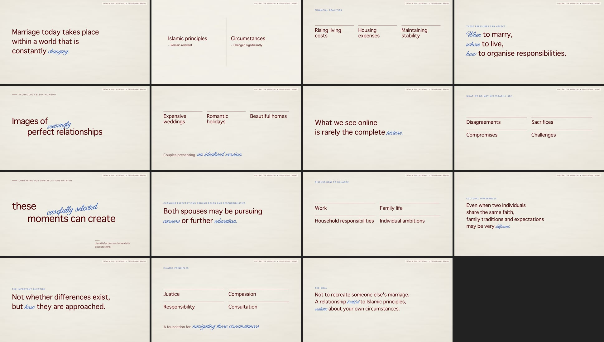

# Storyboard — Module 01: The sacred purpose of marriage

Lesson `lifelink-course-L01` · 36:05.3 · 250 scenes · 16 sections · 16:9

## Creative plan: Module 01, opening (0:00–0:40.7), preview for approval

**Tone:** warm welcome → quiet significance → inclusive → the academy's core belief.

| Scene | Time | Narration (transcript) | Treatment | Why |
|---|---|---|---|---|
| s001 | 0.0–7.6 | "Assalamu Alaikum, welcome to LifeLink Marriage Academy brought to you by Educating Excellence Group." | Course intro (The Folder) | Opening of the whole academy; brand moment |
| s002 | 7.6–16.4 | "…this important first step towards preparing for one of the most significant relationships of your life." | Reflection on royal blue | The weight of the decision; stillness, not spectacle |
| s003 | 16.4–29.0 | "Whether you are considering marriage for the first time, have previously been married or are now exploring the possibility of remarriage, this programme has been developed to support you." | Equal Columns (new) | Three kinds of learner shown as equals: no numbers, no ranking, no dimming |
| s004 | 29.0–40.7 | "At LifeLink we believe that finding the right life partner is important, however we also believe that becoming the right life partner is equally important." | Key statement, script emphasis on *Becoming*, *equally* | The academy's central idea: the shift from finding to becoming |

**Flags for the client:**
- "Educating Excellence Group" is spoken but not shown on screen. Should it appear (e.g. on the intro card)?
- Module title "The sacred purpose of marriage" is taken from the narration at ~2:05 ("In this first module, we will explore the sacred purpose of marriage").
- Transcription needs checking later in the lesson (not in this preview): "Smillah" → Bismillah? "Surah Arghum" → Surah Ar-Rum (30:21)? "a manner of sacred trust" → "an amanah, a sacred trust"?

## Creative plan: Module 01, extension (0:40.7–1:00), preview for approval

**Tone:** the reframe ("not simply… it is about…") → the faith's definition. Text-only throughout: the narration offers nothing meaningful to picture, so no illustration or decorative motion (client rule).

| Scene | Time | Narration (transcript) | Treatment | Why |
|---|---|---|---|---|
| s005 | 40.7–45.1 | "Marriage is not simply about finding someone who meets a list of expectations," | Statement, plain ink type on paper, each line rises as spoken | The "not this" half of the reframe: no script, no object, so the list gets no visual weight; cut sits in the pause after "expectations" |
| s006 | 45.1–54.4 | "it is about developing the knowledge, emotional maturity, understanding and character needed to build a successful relationship." | Equal Columns (as s003), four qualities, closing in script | The "but this" half: four qualities as unranked equals, each appearing on its word; the outcome lands in royal script |
| s007 | 54.4–60.0 | "In Islam, marriage, or nikah, is a sacred covenant." | Still, centred definition card; script emphasis on *sacred covenant* | The faith's definition; nothing to picture, so a clean text card that holds still once complete. Emphasis on the meaning, not on the uncertain term |

**Flags for the client:**
- Spelling of "nikah" (spoken 56.9–57.4 s; transcription confidence 0.51, not yet listened to): please confirm the house spelling (nikah / nikkah / nikāḥ). Shown in plain type until confirmed.
- Display punctuation: "expectations," is shown as "expectations." because the sentence is split across s005/s006; "the" before "knowledge" is dropped so the four qualities read in parallel. No other words changed.

## Scenes

### 77. sec-07-01 · kineticStatement · 11:10.4–11:16.6 (6.2s)

**On screen:** Marriage today takes place / within a world that is / constantly changing. / changing  
**Narration:** Marriage today takes place within a world that is constantly changing.

### 78. sec-07-02 · comparison · 11:16.6–11:28.0 (11.4s)

**On screen:** Islamic principles / Remain relevant / Circumstances / Changed significantly  
**Narration:** Although the Islamic principles that guide marriage remain relevant, the circumstances in which couples live have changed significantly. Let us consider some of these challenges.

### 79. sec-07-03 · parallelPhrases · 11:28.0–11:40.6 (12.6s)

**On screen:** Financial realities / Rising living costs / Housing expenses / Maintaining stability  
**Narration:** Firstly, financial realities. Many couples are dealing with rising living costs, housing expenses and the pressures of maintaining financial stability.

### 80. sec-07-04 · kineticStatement · 11:40.6–11:49.4 (8.8s)

**On screen:** When to marry, / where to live, / how to organise responsibilities. / When / where / how / These pressures can affect  
**Narration:** These pressures can affect when individuals feel ready to marry, where they choose to live and how they organise their responsibilities.

### 81. sec-07-05 · statementCollision · 11:49.4–11:59.2 (9.8s)

**On screen:** Technology & social media / Images of / seemingly / perfect relationships  
**Narration:** Secondly, we have the influence of technology in social media. We are constantly exposed to images of seemingly perfect relationships. We

### 82. sec-07-06 · parallelPhrases · 11:59.2–12:07.6 (8.4s)

**On screen:** Expensive weddings / Romantic holidays / Beautiful homes / Couples presenting / an idealised version  
**Narration:** see expensive weddings, romantic holidays, beautiful homes and couples presenting an idealised version of their lives.

### 83. sec-07-07 · kineticStatement · 12:07.6–12:11.3 (3.7s)

**On screen:** What we see online / is rarely the complete picture. / picture  
**Narration:** But what we see online is rarely the complete picture.

### 84. sec-07-08 · parallelPhrases · 12:11.3–12:20.6 (9.3s)

**On screen:** What we do not necessarily see / Disagreements / Sacrifices / Compromises / Challenges  
**Narration:** We do not necessarily see the disagreements, sacrifices, compromises or challenges that every relationship may experience.

### 85. sec-07-09 · statementCollision · 12:20.6–12:30.6 (10.0s)

**On screen:** Comparing our own relationship with / these / carefully selected / moments can create / dissatisfaction and unrealistic expectations.  
**Narration:** Comparing our own relationship with these carefully selected moments can create dissatisfaction and unrealistic expectations.

### 86. sec-07-10 · kineticStatement · 12:30.6–12:40.6 (10.0s)

**On screen:** Both spouses may be pursuing / careers or further education. / careers / education / Changing expectations around roles and responsibilities  
**Narration:** Thirdly, we have changing expectations around roles and responsibilities. For example, both spouses may be pursuing careers or further education.

### 87. sec-07-11 · parallelPhrases · 12:40.6–12:49.8 (9.2s)

**On screen:** Discuss how to balance / Work / Family life / Household responsibilities / Individual ambitions  
**Narration:** Couples may need to discuss how they will balance work, family life, household responsibilities and their individual ambitions.

### 88. sec-07-12 · kineticStatement · 12:49.8–13:00.4 (10.6s)

**On screen:** Even when two individuals / share the same faith, / family traditions and expectations / may be very different. / different / Cultural differences  
**Narration:** Cultural differences can also create challenges. Even when two individuals share the same faith, their family traditions and expectations may be very different.

### 89. sec-07-13 · kineticStatement · 13:00.4–13:06.8 (6.4s)

**On screen:** Not whether differences exist, / but how they are approached. / how / The important question  
**Narration:** The important question is not whether these differences exist but how they are approached.

### 90. sec-07-14 · parallelPhrases · 13:06.8–13:17.0 (10.2s)

**On screen:** Islamic principles / Justice / Compassion / Responsibility / Consultation / A foundation for / navigating these circumstances  
**Narration:** Islamic principles of justice, compassion, responsibility and consultation provide a foundation for navigating these circumstances.

### 91. sec-07-15 · kineticStatement · 13:17.0–13:29.6 (12.6s)

**On screen:** Not to recreate someone else's marriage. / A relationship faithful to Islamic principles, / realistic about your own circumstances. / faithful / realistic / The goal  
**Narration:** The goal is not to recreate someone else's marriage, it is to develop a relationship that is faithful to Islamic principles while being realistic about your own circumstances.
