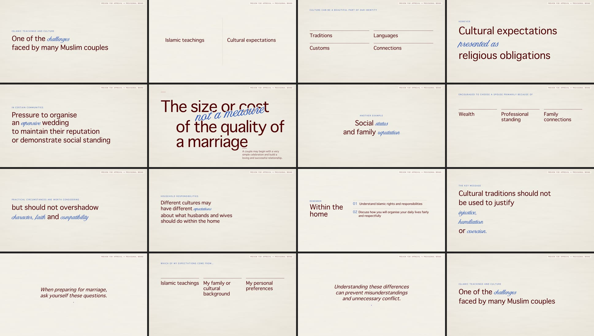

# Storyboard — Module 01: The sacred purpose of marriage

Lesson `lifelink-course-L01` · 36:05.3 · 250 scenes · 16 sections · 16:9

## Creative plan: Module 01, opening (0:00–0:40.7), preview for approval

**Tone:** warm welcome → quiet significance → inclusive → the academy's core belief.

| Scene | Time | Narration (transcript) | Treatment | Why |
|---|---|---|---|---|
| s001 | 0.0–7.6 | "Assalamu Alaikum, welcome to LifeLink Marriage Academy brought to you by Educating Excellence Group." | Course intro (The Folder) | Opening of the whole academy; brand moment |
| s002 | 7.6–16.4 | "…this important first step towards preparing for one of the most significant relationships of your life." | Reflection on royal blue | The weight of the decision; stillness, not spectacle |
| s003 | 16.4–29.0 | "Whether you are considering marriage for the first time, have previously been married or are now exploring the possibility of remarriage, this programme has been developed to support you." | Equal Columns (new) | Three kinds of learner shown as equals: no numbers, no ranking, no dimming |
| s004 | 29.0–40.7 | "At LifeLink we believe that finding the right life partner is important, however we also believe that becoming the right life partner is equally important." | Key statement, script emphasis on *Becoming*, *equally* | The academy's central idea: the shift from finding to becoming |

**Flags for the client:**
- "Educating Excellence Group" is spoken but not shown on screen. Should it appear (e.g. on the intro card)?
- Module title "The sacred purpose of marriage" is taken from the narration at ~2:05 ("In this first module, we will explore the sacred purpose of marriage").
- Transcription needs checking later in the lesson (not in this preview): "Smillah" → Bismillah? "Surah Arghum" → Surah Ar-Rum (30:21)? "a manner of sacred trust" → "an amanah, a sacred trust"?

## Creative plan: Module 01, extension (0:40.7–1:00), preview for approval

**Tone:** the reframe ("not simply… it is about…") → the faith's definition. Text-only throughout: the narration offers nothing meaningful to picture, so no illustration or decorative motion (client rule).

| Scene | Time | Narration (transcript) | Treatment | Why |
|---|---|---|---|---|
| s005 | 40.7–45.1 | "Marriage is not simply about finding someone who meets a list of expectations," | Statement, plain ink type on paper, each line rises as spoken | The "not this" half of the reframe: no script, no object, so the list gets no visual weight; cut sits in the pause after "expectations" |
| s006 | 45.1–54.4 | "it is about developing the knowledge, emotional maturity, understanding and character needed to build a successful relationship." | Equal Columns (as s003), four qualities, closing in script | The "but this" half: four qualities as unranked equals, each appearing on its word; the outcome lands in royal script |
| s007 | 54.4–60.0 | "In Islam, marriage, or nikah, is a sacred covenant." | Still, centred definition card; script emphasis on *sacred covenant* | The faith's definition; nothing to picture, so a clean text card that holds still once complete. Emphasis on the meaning, not on the uncertain term |

**Flags for the client:**
- Spelling of "nikah" (spoken 56.9–57.4 s; transcription confidence 0.51, not yet listened to): please confirm the house spelling (nikah / nikkah / nikāḥ). Shown in plain type until confirmed.
- Display punctuation: "expectations," is shown as "expectations." because the sentence is split across s005/s006; "the" before "knowledge" is dropped so the four qualities read in parallel. No other words changed.

## Scenes

### 92. sec-08-01 · kineticStatement · 13:29.6–13:35.5 (5.9s)

**On screen:** One of the challenges / faced by many Muslim couples / challenges / Islamic teachings and culture  
**Narration:** One of the challenges faced by many Muslim couples is

### 93. sec-08-02 · comparison · 13:35.5–13:41.2 (5.7s)

**On screen:** Islamic teachings / Cultural expectations  
**Narration:** distinguishing between Islamic teachings and cultural expectations.

### 94. sec-08-03 · parallelPhrases · 13:41.2–13:50.0 (8.8s)

**On screen:** Culture can be a beautiful part of our identity / Traditions / Languages / Customs / Connections  
**Narration:** Culture can be a beautiful part of our identity. It gives us traditions, languages, customs and connections with our families and communities.

### 95. sec-08-04 · kineticStatement · 13:50.0–14:00.6 (10.6s)

**On screen:** Cultural expectations / presented as / religious obligations / presented / as / However  
**Narration:** However, difficulties can arise when cultural expectations are presented as though they are religious obligations. Let us look at some examples.

### 96. sec-08-05 · kineticStatement · 14:00.6–14:13.2 (12.6s)

**On screen:** Pressure to organise an expensive wedding / to maintain their reputation / or demonstrate social standing / expensive / In certain communities  
**Narration:** In certain communities, there may be significant pressure to organize an expensive wedding. Families may feel that a wedding must be lavish to maintain their reputation or demonstrate social standing.

### 97. sec-08-06 · statementCollision · 14:13.2–14:26.8 (13.6s)

**On screen:** The size or cost / not a measure / of the quality of a marriage / A couple may begin married life with a very simple celebration and go on to build a loving and successful relationship.  
**Narration:** However, the size or cost of a wedding is not a measure of the quality of a marriage. A couple may begin married life with a very simple celebration and go on to build a loving and successful relationship.

### 98. sec-08-07 · kineticStatement · 14:26.8–14:33.2 (6.4s)

**On screen:** Social status / and family reputation / status / reputation / Another example  
**Narration:** Another example is the emphasis placed on social status and family reputation.

### 99. sec-08-08 · parallelPhrases · 14:33.2–14:42.6 (9.4s)

**On screen:** Encouraged to choose a spouse primarily because of / Wealth / Professional standing / Family connections  
**Narration:** Sometimes individuals are encouraged to choose a spouse primarily because of wealth, professional standing or family connections.

### 100. sec-08-09 · kineticStatement · 14:42.6–14:51.6 (9.0s)

**On screen:** but should not overshadow / character, faith and compatibility / character / faith / compatibility / Practical circumstances are worth considering  
**Narration:** Although practical circumstances are worth considering, these should not overshadow character, faith and compatibility.

### 101. sec-08-10 · kineticStatement · 14:51.6–15:01.6 (10.0s)

**On screen:** Different cultures may have different expectations / about what husbands and wives should do within the home / expectations / Household responsibilities  
**Narration:** We must also consider household responsibilities. Different cultures may have different expectations about what husbands and wives should do within the home.

### 102. sec-08-11 · takeaway · 15:01.6–15:12.6 (11.0s)

**On screen:** Within the home / Understand Islamic rights and responsibilities / Discuss how you will organise your daily lives fairly and respectfully  
**Narration:** It is important to understand Islamic rights and responsibilities that's also discussing how a couple will organize their daily lives fairly and respectfully.

### 103. sec-08-12 · kineticStatement · 15:12.6–15:22.7 (10.1s)

**On screen:** Cultural traditions should not / be used to justify / injustice, / humiliation / or coercion. / injustice, / humiliation / coercion. / The key message  
**Narration:** The key message here is that cultural traditions should not be used to justify injustice, humiliation or coercion.

### 104. sec-08-13 · quietReflection · 15:22.7–15:26.8 (4.1s)

**On screen:** When preparing for marriage, ask yourself these questions.  
**Narration:** When preparing for marriage, ask yourself these questions.

### 105. sec-08-14 · parallelPhrases · 15:26.8–15:39.6 (12.8s)

**On screen:** Which of my expectations come from… / Islamic teachings / My family or cultural background / My personal preferences  
**Narration:** Which of my expectations come from Islamic teachings? Which come from my family or cultural background? And which are simply my personal preferences?

### 106. sec-08-15 · quietReflection · 15:39.6–15:46.8 (7.2s)

**On screen:** Understanding these differences can prevent misunderstandings and unnecessary conflict.  
**Narration:** Understanding these differences can prevent misunderstandings and unnecessary conflict.
