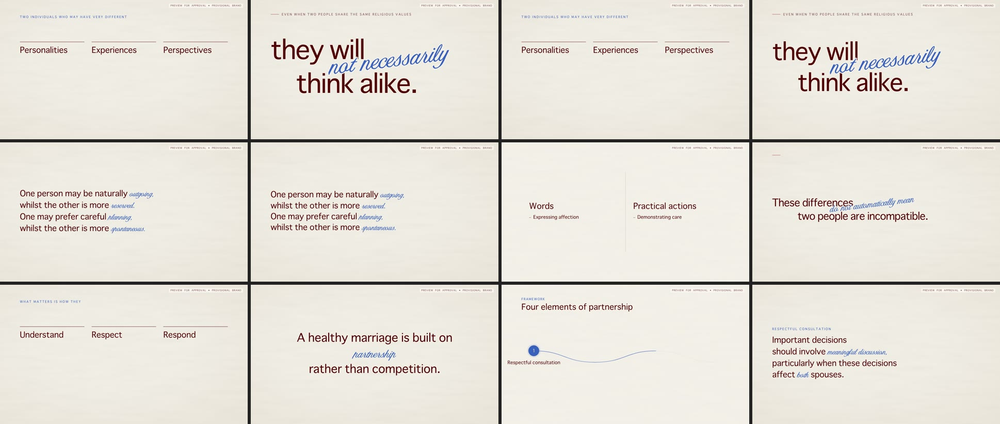

# Storyboard — Module 01: The sacred purpose of marriage

Lesson `lifelink-course-L01` · 36:08.3 · 149 scenes · 16 sections · 16:9

## Creative plan: Module 01, opening (0:00–0:40.7), preview for approval

**Tone:** warm welcome → quiet significance → inclusive → the academy's core belief.

| Scene | Time | Narration (transcript) | Treatment | Why |
|---|---|---|---|---|
| s001 | 0.0–7.6 | "Assalamu Alaikum, welcome to LifeLink Marriage Academy brought to you by Educating Excellence Group." | Course intro (The Folder) | Opening of the whole academy; brand moment |
| s002 | 7.6–16.4 | "…this important first step towards preparing for one of the most significant relationships of your life." | Reflection on royal blue | The weight of the decision; stillness, not spectacle |
| s003 | 16.4–29.0 | "Whether you are considering marriage for the first time, have previously been married or are now exploring the possibility of remarriage, this programme has been developed to support you." | Equal Columns (new) | Three kinds of learner shown as equals: no numbers, no ranking, no dimming |
| s004 | 29.0–40.7 | "At LifeLink we believe that finding the right life partner is important, however we also believe that becoming the right life partner is equally important." | Key statement, script emphasis on *Becoming*, *equally* | The academy's central idea: the shift from finding to becoming |

**Flags for the client:**
- "Educating Excellence Group" is spoken but not shown on screen. Should it appear (e.g. on the intro card)?
- Module title "The sacred purpose of marriage" is taken from the narration at ~2:05 ("In this first module, we will explore the sacred purpose of marriage").
- Transcription needs checking later in the lesson (not in this preview): "Smillah" → Bismillah? "Surah Arghum" → Surah Ar-Rum (30:21)? "a manner of sacred trust" → "an amanah, a sacred trust"?

## Creative plan: Module 01, extension (0:40.7–1:00), preview for approval

**Tone:** the reframe ("not simply… it is about…") → the faith's definition. Text-only throughout: the narration offers nothing meaningful to picture, so no illustration or decorative motion (client rule).

| Scene | Time | Narration (transcript) | Treatment | Why |
|---|---|---|---|---|
| s005 | 40.7–45.1 | "Marriage is not simply about finding someone who meets a list of expectations," | Statement, plain ink type on paper, each line rises as spoken | The "not this" half of the reframe: no script, no object, so the list gets no visual weight; cut sits in the pause after "expectations" |
| s006 | 45.1–54.4 | "it is about developing the knowledge, emotional maturity, understanding and character needed to build a successful relationship." | Equal Columns (as s003), four qualities, closing in script | The "but this" half: four qualities as unranked equals, each appearing on its word; the outcome lands in royal script |
| s007 | 54.4–60.0 | "In Islam, marriage, or nikah, is a sacred covenant." | Still, centred definition card; script emphasis on *sacred covenant* | The faith's definition; nothing to picture, so a clean text card that holds still once complete. Emphasis on the meaning, not on the uncertain term |

**Flags for the client:**
- Spelling of "nikah" (spoken 56.9–57.4 s; transcription confidence 0.51, not yet listened to): please confirm the house spelling (nikah / nikkah / nikāḥ). Shown in plain type until confirmed.
- Display punctuation: "expectations," is shown as "expectations." because the sentence is split across s005/s006; "the" before "knowledge" is dropped so the four qualities read in parallel. No other words changed.

## Scenes

### 60. sec-09-01 · wordStack · 15:46.8–15:55.6 (8.9s)

**On screen:** This brings together two individuals who may have very different / Personalities / Experiences / Perspectives / offset  
**Narration:** This brings together two individuals who may have very different personalities, experiences and perspectives.

### 61. sec-09-02 · highlightLine · 15:55.6–16:01.3 (5.6s)

**On screen:** Even when two people share the same religious values, / they will not necessarily think alike. / think alike / sky  
**Narration:** Even when two people share the same religious values, they will not necessarily think alike. One

### 62. sec-09-03 · kineticStatement · 16:01.3–16:10.9 (9.6s)

**On screen:** One person may be naturally outgoing, / whilst the other is more reserved. / One may prefer careful planning, / whilst the other is more spontaneous. / outgoing / reserved / planning / spontaneous / rise  
**Narration:** person may be naturally outgoing, whilst the other is more reserved. One may prefer careful planning, whilst the other is more spontaneous.

### 63. sec-09-04 · comparison · 16:10.9–16:16.9 (6.0s)

**On screen:** Words / Expressing affection / Practical actions / Demonstrating care  
**Narration:** One may express affection through words, whilst the other demonstrates care through practical actions.

### 64. sec-09-05 · statementCollision · 16:16.9–16:22.2 (5.3s)

**On screen:** These differences / do not automatically mean / two people are incompatible.  
**Narration:** These differences do not automatically mean that two people are incompatible.

### 65. sec-09-06 · wordStack · 16:22.2–16:27.9 (5.7s)

**On screen:** What matters is how they / Understand / Respect / Respond / column  
**Narration:** What matters is how they understand, respect and respond to those differences.

### 66. sec-09-07 · pullQuote · 16:27.9–16:33.0 (5.1s)

**On screen:** A healthy marriage is built on partnership / rather than competition. / partnership  
**Narration:** A healthy marriage is built on partnership rather than competition.

### 67. sec-09-08 · bridgePlanks · 16:33.0–18:02.2 (89.2s)

**On screen:** Respectful consultation / Shared responsibilities / Mutual support / Honouring individuality / work together  
**Narration:** Let us consider the four elements shown on this slide. The first is respectful consultation. Important decisions should involve meaningful discussion, particularly when these decisions affect both spouses. The second is shared responsibilities. Marriage involves practical commitments and couples need to understand how these responsibilities will be managed. This does not necessarily mean dividing every task equally, it means developing arrangements that are fair, understood and agreed upon. The third is mutual support. A successful partnership involves supporting one another's personal, professional and spiritual development. For example, if one spouse wishes to continue their education, a supportive partner will consider how that ambition can be accommodated alongside their shared responsibilities. The fourth is honouring individuality. Being married does not mean losing your identity. Both spouses remain individuals with their own personalities, interests, strengths and aspirations. Marriage should provide opportunities for growth rather than requiring one person to disappear into their expectations of another. Ultimately, a healthy partnership is not about asking who has more power. It's about asking how can we work together to build a relationship in which both

### 68. sec-09-09 · chapterRecap · 18:02.2–18:06.4 (4.2s)

**On screen:** Partnership, not competition / bridgePlanks / Respectful consultation / Shared responsibilities / Mutual support / Honouring individuality / work together / Respected / Supported / Valued  
**Narration:** of us are respected, supported and valued.
