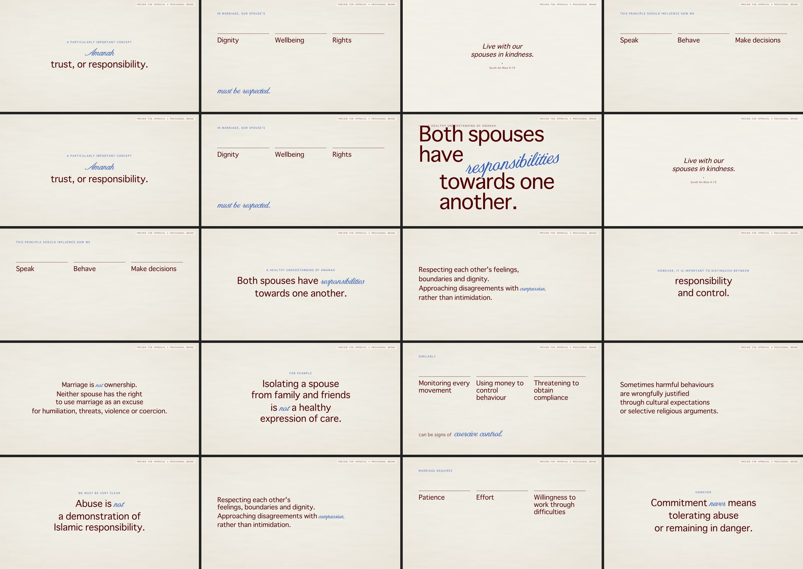

# Storyboard — Module 01: The sacred purpose of marriage

Lesson `lifelink-course-L01` · 36:05.3 · 250 scenes · 16 sections · 16:9

## Creative plan: Module 01, opening (0:00–0:40.7), preview for approval

**Tone:** warm welcome → quiet significance → inclusive → the academy's core belief.

| Scene | Time | Narration (transcript) | Treatment | Why |
|---|---|---|---|---|
| s001 | 0.0–7.6 | "Assalamu Alaikum, welcome to LifeLink Marriage Academy brought to you by Educating Excellence Group." | Course intro (The Folder) | Opening of the whole academy; brand moment |
| s002 | 7.6–16.4 | "…this important first step towards preparing for one of the most significant relationships of your life." | Reflection on royal blue | The weight of the decision; stillness, not spectacle |
| s003 | 16.4–29.0 | "Whether you are considering marriage for the first time, have previously been married or are now exploring the possibility of remarriage, this programme has been developed to support you." | Equal Columns (new) | Three kinds of learner shown as equals: no numbers, no ranking, no dimming |
| s004 | 29.0–40.7 | "At LifeLink we believe that finding the right life partner is important, however we also believe that becoming the right life partner is equally important." | Key statement, script emphasis on *Becoming*, *equally* | The academy's central idea: the shift from finding to becoming |

**Flags for the client:**
- "Educating Excellence Group" is spoken but not shown on screen. Should it appear (e.g. on the intro card)?
- Module title "The sacred purpose of marriage" is taken from the narration at ~2:05 ("In this first module, we will explore the sacred purpose of marriage").
- Transcription needs checking later in the lesson (not in this preview): "Smillah" → Bismillah? "Surah Arghum" → Surah Ar-Rum (30:21)? "a manner of sacred trust" → "an amanah, a sacred trust"?

## Creative plan: Module 01, extension (0:40.7–1:00), preview for approval

**Tone:** the reframe ("not simply… it is about…") → the faith's definition. Text-only throughout: the narration offers nothing meaningful to picture, so no illustration or decorative motion (client rule).

| Scene | Time | Narration (transcript) | Treatment | Why |
|---|---|---|---|---|
| s005 | 40.7–45.1 | "Marriage is not simply about finding someone who meets a list of expectations," | Statement, plain ink type on paper, each line rises as spoken | The "not this" half of the reframe: no script, no object, so the list gets no visual weight; cut sits in the pause after "expectations" |
| s006 | 45.1–54.4 | "it is about developing the knowledge, emotional maturity, understanding and character needed to build a successful relationship." | Equal Columns (as s003), four qualities, closing in script | The "but this" half: four qualities as unranked equals, each appearing on its word; the outcome lands in royal script |
| s007 | 54.4–60.0 | "In Islam, marriage, or nikah, is a sacred covenant." | Still, centred definition card; script emphasis on *sacred covenant* | The faith's definition; nothing to picture, so a clean text card that holds still once complete. Emphasis on the meaning, not on the uncertain term |

**Flags for the client:**
- Spelling of "nikah" (spoken 56.9–57.4 s; transcription confidence 0.51, not yet listened to): please confirm the house spelling (nikah / nikkah / nikāḥ). Shown in plain type until confirmed.
- Display punctuation: "expectations," is shown as "expectations." because the sentence is split across s005/s006; "the" before "knowledge" is dropped so the four qualities read in parallel. No other words changed.

## Scenes

### 128. sec-10-01 · kineticStatement · 18:06.4–18:15.6 (9.2s)

**On screen:** Amanah / trust, or responsibility. / Amanah / A particularly important concept  
**Narration:** Now come to a particularly important concept, a manna. A manna means trust or responsibility.

### 129. sec-10-02 · parallelPhrases · 18:15.6–18:23.6 (8.0s)

**On screen:** In marriage, our spouse's / Dignity / Wellbeing / Rights / must be respected.  
**Narration:** In marriage, this means recognizing that our spouse is someone whose dignity, well -being and rights must be respected.

### 130. sec-10-03 · quietReflection · 18:23.6–18:30.9 (7.3s)

**On screen:** Live with our spouses in kindness. / Surah An-Nisa 4:19  
**Narration:** Allah tells us in Surah An -Nisa verse 19 to live with our spouses in kindness.

### 131. sec-10-04 · parallelPhrases · 18:30.9–18:37.9 (7.0s)

**On screen:** This principle should influence how we / Speak / Behave / Make decisions  
**Narration:** This principle should influence how we speak, behave and make decisions within marriage.

### 132. sec-10-05 · kineticStatement · 18:37.9–18:46.2 (8.3s)

**On screen:** Both spouses have responsibilities / towards one another. / responsibilities / A healthy understanding of Amanah  
**Narration:** A healthy understanding of a manna involves recognizing that both spouses have responsibilities towards one another.

### 133. sec-10-06 · kineticStatement · 18:46.2–18:56.6 (10.4s)

**On screen:** Respecting each other's feelings, / boundaries and dignity. / Approaching disagreements with compassion, / rather than intimidation. / compassion  
**Narration:** It means respecting each other's feelings, boundaries and dignity. It also means approaching disagreements with compassion rather than intimidation.

### 134. sec-10-07 · kineticStatement · 18:56.6–19:02.9 (6.3s)

**On screen:** responsibility / and control. / However, it is important to distinguish between  
**Narration:** However, it is important to distinguish between responsibility and control.

### 135. sec-10-08 · kineticStatement · 19:02.9–19:12.6 (9.7s)

**On screen:** Marriage is not ownership. / Neither spouse has the right to use marriage as an excuse / for humiliation, threats, violence or coercion. / not  
**Narration:** Marriage is not ownership. Neither spouse has the right to use marriage as an excuse for humiliation, threats, violence or coercion.

### 136. sec-10-09 · kineticStatement · 19:12.6–19:23.2 (10.6s)

**On screen:** Isolating a spouse from family and friends / is not a healthy expression of care. / not / For example  
**Narration:** For example, preventing the spouse from maintaining appropriate relationships with family and friends as a means of isolating them is not a healthy expression of care.

### 137. sec-10-10 · parallelPhrases · 19:23.2–19:34.4 (11.2s)

**On screen:** Similarly / Monitoring every movement / Using money to control behaviour / Threatening to obtain compliance / can be signs of / coercive control.  
**Narration:** Similarly, monitoring someone's every movement, using money to control their behavior or threatening them to obtain compliance can be signs of coercive control.

### 138. sec-10-11 · kineticStatement · 19:34.4–19:42.5 (8.1s)

**On screen:** Sometimes harmful behaviours / are wrongfully justified / through cultural expectations / or selective religious arguments.  
**Narration:** Sometimes harmful behaviors are wrongfully justified through cultural expectations or selective religious arguments.

### 139. sec-10-12 · kineticStatement · 19:42.5–19:48.3 (5.8s)

**On screen:** Abuse is not / a demonstration of Islamic responsibility. / not / We must be very clear  
**Narration:** We must be very clear that abuse is not a demonstration of Islamic responsibility.

### 140. sec-10-13 · parallelPhrases · 19:48.3–19:56.9 (8.6s)

**On screen:** Marriage requires / Patience / Effort / Willingness to work through difficulties  
**Narration:** Let us also consider commitment. Marriage requires patience, effort and the willingness to work through difficulties.

### 141. sec-10-14 · kineticStatement · 19:56.9–20:03.5 (6.6s)

**On screen:** Commitment never means / tolerating abuse / or remaining in danger. / never / However  
**Narration:** However, commitment never means that someone must tolerate abuse or remain in danger.

### 142. sec-10-15 · kineticStatement · 20:03.5–20:09.2 (5.7s)

**On screen:** should protect dignity and safety / for both. / dignity / safety / A healthy relationship  
**Narration:** A healthy relationship should protect the dignity and safety of both individuals.

### 143. sec-10-16a · kineticStatement · 20:09.2–20:14.9 (5.7s)

**On screen:** Trust is built through consistent behaviour. / consistent / As you prepare for marriage  
**Narration:** As you prepare for marriage, remember that trust is built through consistent behavior.

### 144. sec-10-16b · parallelPhrases · 20:14.9–20:20.2 (5.3s)

**On screen:** It develops when people feel / Respected / Listened to / Emotionally safe  
**Narration:** It develops when people feel respected, listened to and emotionally safe.

### 145. sec-10-17 · kineticStatement · 20:20.2–20:28.5 (8.3s)

**On screen:** Protecting the trust placed in us, / not using that trust as power over another. / Protecting / Amanah  
**Narration:** Amana is about protecting the trust placed in us, not using that trust to exercise power over another person.
