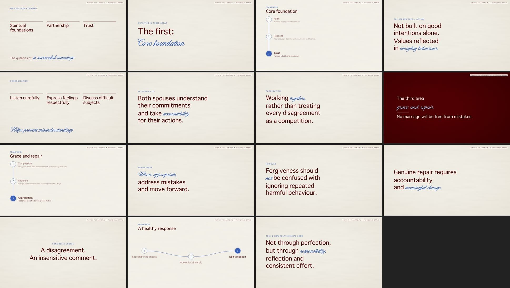

# Storyboard — Module 01: The sacred purpose of marriage

Lesson `lifelink-course-L01` · 36:05.3 · 250 scenes · 16 sections · 16:9

## Creative plan: Module 01, opening (0:00–0:40.7), preview for approval

**Tone:** warm welcome → quiet significance → inclusive → the academy's core belief.

| Scene | Time | Narration (transcript) | Treatment | Why |
|---|---|---|---|---|
| s001 | 0.0–7.6 | "Assalamu Alaikum, welcome to LifeLink Marriage Academy brought to you by Educating Excellence Group." | Course intro (The Folder) | Opening of the whole academy; brand moment |
| s002 | 7.6–16.4 | "…this important first step towards preparing for one of the most significant relationships of your life." | Reflection on royal blue | The weight of the decision; stillness, not spectacle |
| s003 | 16.4–29.0 | "Whether you are considering marriage for the first time, have previously been married or are now exploring the possibility of remarriage, this programme has been developed to support you." | Equal Columns (new) | Three kinds of learner shown as equals: no numbers, no ranking, no dimming |
| s004 | 29.0–40.7 | "At LifeLink we believe that finding the right life partner is important, however we also believe that becoming the right life partner is equally important." | Key statement, script emphasis on *Becoming*, *equally* | The academy's central idea: the shift from finding to becoming |

**Flags for the client:**
- "Educating Excellence Group" is spoken but not shown on screen. Should it appear (e.g. on the intro card)?
- Module title "The sacred purpose of marriage" is taken from the narration at ~2:05 ("In this first module, we will explore the sacred purpose of marriage").
- Transcription needs checking later in the lesson (not in this preview): "Smillah" → Bismillah? "Surah Arghum" → Surah Ar-Rum (30:21)? "a manner of sacred trust" → "an amanah, a sacred trust"?

## Creative plan: Module 01, extension (0:40.7–1:00), preview for approval

**Tone:** the reframe ("not simply… it is about…") → the faith's definition. Text-only throughout: the narration offers nothing meaningful to picture, so no illustration or decorative motion (client rule).

| Scene | Time | Narration (transcript) | Treatment | Why |
|---|---|---|---|---|
| s005 | 40.7–45.1 | "Marriage is not simply about finding someone who meets a list of expectations," | Statement, plain ink type on paper, each line rises as spoken | The "not this" half of the reframe: no script, no object, so the list gets no visual weight; cut sits in the pause after "expectations" |
| s006 | 45.1–54.4 | "it is about developing the knowledge, emotional maturity, understanding and character needed to build a successful relationship." | Equal Columns (as s003), four qualities, closing in script | The "but this" half: four qualities as unranked equals, each appearing on its word; the outcome lands in royal script |
| s007 | 54.4–60.0 | "In Islam, marriage, or nikah, is a sacred covenant." | Still, centred definition card; script emphasis on *sacred covenant* | The faith's definition; nothing to picture, so a clean text card that holds still once complete. Emphasis on the meaning, not on the uncertain term |

**Flags for the client:**
- Spelling of "nikah" (spoken 56.9–57.4 s; transcription confidence 0.51, not yet listened to): please confirm the house spelling (nikah / nikkah / nikāḥ). Shown in plain type until confirmed.
- Display punctuation: "expectations," is shown as "expectations." because the sentence is split across s005/s006; "the" before "knowledge" is dropped so the four qualities read in parallel. No other words changed.

## Scenes

### 146. sec-11-01 · parallelPhrases · 20:28.5–20:42.9 (14.4s)

**On screen:** We have now explored / Spiritual foundations / Partnership / Trust / The qualities of / a successful marriage  
**Narration:** We have now explored the spiritual foundations of marriage, the importance of partnership and the concept of trust. Let us bring these ideas together by considering the qualities that contribute to a successful marriage.

### 147. sec-11-02 · kineticStatement · 20:42.9–20:52.9 (10.0s)

**On screen:** The first: / Core foundation / Core / foundation / Qualities in three areas  
**Narration:** This slide organizes those qualities into three areas. The first is the core foundation. This includes faith, respect and trust.

### 148. sec-11-03 · stepsDiagram · 20:52.9–21:07.9 (15.0s)

**On screen:** Core foundation / Faith / A moral and spiritual foundation / Respect / Your spouse's dignity, opinions, needs and feelings / Trust / Honest, reliable and consistent  
**Narration:** Faith provides a moral and spiritual foundation. Respect means recognizing your spouse's dignity, opinions, needs and feelings. Trust develops when we are honest, reliable and consistent in our behavior.

### 149. sec-11-04 · kineticStatement · 21:07.9–21:19.9 (12.0s)

**On screen:** Not built on good intentions alone. / Values reflected in everyday behaviour. / everyday / behaviour / The second area · Action  
**Narration:** The second area is action. A successful marriage is not built on good intentions alone. Our values must be reflected in our everyday behavior.

### 150. sec-11-05 · parallelPhrases · 21:19.9–21:31.5 (11.6s)

**On screen:** Communication / Listen carefully / Express feelings respectfully / Discuss difficult subjects / Helps prevent misunderstandings  
**Narration:** Communication is particularly important. Being able to listen carefully, express our feelings respectfully and discuss difficult subjects helps prevent misunderstandings.

### 151. sec-11-06 · kineticStatement · 21:31.5–21:40.9 (9.4s)

**On screen:** Both spouses understand their commitments / and take accountability for their actions. / accountability / Responsibility  
**Narration:** Responsibility is equally important. Both spouses must understand their commitments and take accountability for their actions.

### 152. sec-11-07 · kineticStatement · 21:40.9–21:46.9 (6.0s)

**On screen:** Working together, / rather than treating every disagreement / as a competition. / together / Cooperation  
**Narration:** Cooperation allows couples to work together rather than treating every disagreement as a competition.

### 153. sec-11-08 · reflectionField · 21:46.9–21:56.5 (9.5s)

**On screen:** The third area / grace and repair / No marriage will be free from mistakes. / oxblood  
**Narration:** The third area is grace and repair. This is especially important because no marriage will be free from mistakes.

### 154. sec-11-09 · stepsDiagram · 21:56.5–22:11.5 (15.0s)

**On screen:** Grace and repair / Compassion / Recognise when your spouse may be experiencing difficulty / Patience / Manage frustration without reacting in harmful ways / Appreciation / Recognise the effort your spouse makes  
**Narration:** Compassion allows us to recognize when our spouse may be experiencing difficulty. Patience helps us manage frustration without reacting in harmful ways. Appreciation reminds us to recognize the effort our spouse makes.

### 155. sec-11-10 · kineticStatement · 22:11.5–22:17.0 (5.5s)

**On screen:** Where appropriate, / address mistakes and move forward. / Where / appropriate / Forgiveness  
**Narration:** Forgiveness, where appropriate, allows couples to address mistakes and move forward.

### 156. sec-11-11a · kineticStatement · 22:17.0–22:23.3 (6.3s)

**On screen:** Forgiveness should not be confused with / ignoring repeated harmful behaviour. / not / However  
**Narration:** However, forgiveness should not be confused with ignoring repeated harmful behaviors.

### 157. sec-11-11b · kineticStatement · 22:23.3–22:27.6 (4.3s)

**On screen:** Genuine repair requires / accountability and meaningful change. / meaningful / change  
**Narration:** Genuine repair requires accountability and meaningful change.

### 158. sec-11-12 · kineticStatement · 22:27.6–22:35.0 (7.4s)

**On screen:** A disagreement. / An insensitive comment. / Consider a couple  
**Narration:** Consider a couple who experiences a disagreement. One spouse makes an insensitive comment. A

### 159. sec-11-13 · stepsDiagram · 22:35.0–22:45.0 (10.0s)

**On screen:** A healthy response / Recognise the impact / Apologise sincerely / Don't repeat it  
**Narration:** healthy response would involve recognizing the impact of that comment, apologizing sincerely, and making an effort not to repeat that behavior.

### 160. sec-11-14 · kineticStatement · 22:45.0–22:53.9 (8.9s)

**On screen:** Not through perfection, / but through responsibility, / reflection and consistent effort. / responsibility / This is how relationships grow  
**Narration:** This is how relationships grow. Not through perfection, but through responsibility, reflection, and consistent effort.
