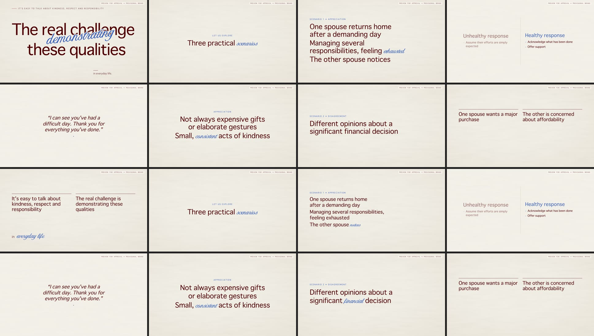

# Storyboard — Module 01: The sacred purpose of marriage

Lesson `lifelink-course-L01` · 36:05.3 · 250 scenes · 16 sections · 16:9

## Creative plan: Module 01, opening (0:00–0:40.7), preview for approval

**Tone:** warm welcome → quiet significance → inclusive → the academy's core belief.

| Scene | Time | Narration (transcript) | Treatment | Why |
|---|---|---|---|---|
| s001 | 0.0–7.6 | "Assalamu Alaikum, welcome to LifeLink Marriage Academy brought to you by Educating Excellence Group." | Course intro (The Folder) | Opening of the whole academy; brand moment |
| s002 | 7.6–16.4 | "…this important first step towards preparing for one of the most significant relationships of your life." | Reflection on royal blue | The weight of the decision; stillness, not spectacle |
| s003 | 16.4–29.0 | "Whether you are considering marriage for the first time, have previously been married or are now exploring the possibility of remarriage, this programme has been developed to support you." | Equal Columns (new) | Three kinds of learner shown as equals: no numbers, no ranking, no dimming |
| s004 | 29.0–40.7 | "At LifeLink we believe that finding the right life partner is important, however we also believe that becoming the right life partner is equally important." | Key statement, script emphasis on *Becoming*, *equally* | The academy's central idea: the shift from finding to becoming |

**Flags for the client:**
- "Educating Excellence Group" is spoken but not shown on screen. Should it appear (e.g. on the intro card)?
- Module title "The sacred purpose of marriage" is taken from the narration at ~2:05 ("In this first module, we will explore the sacred purpose of marriage").
- Transcription needs checking later in the lesson (not in this preview): "Smillah" → Bismillah? "Surah Arghum" → Surah Ar-Rum (30:21)? "a manner of sacred trust" → "an amanah, a sacred trust"?

## Creative plan: Module 01, extension (0:40.7–1:00), preview for approval

**Tone:** the reframe ("not simply… it is about…") → the faith's definition. Text-only throughout: the narration offers nothing meaningful to picture, so no illustration or decorative motion (client rule).

| Scene | Time | Narration (transcript) | Treatment | Why |
|---|---|---|---|---|
| s005 | 40.7–45.1 | "Marriage is not simply about finding someone who meets a list of expectations," | Statement, plain ink type on paper, each line rises as spoken | The "not this" half of the reframe: no script, no object, so the list gets no visual weight; cut sits in the pause after "expectations" |
| s006 | 45.1–54.4 | "it is about developing the knowledge, emotional maturity, understanding and character needed to build a successful relationship." | Equal Columns (as s003), four qualities, closing in script | The "but this" half: four qualities as unranked equals, each appearing on its word; the outcome lands in royal script |
| s007 | 54.4–60.0 | "In Islam, marriage, or nikah, is a sacred covenant." | Still, centred definition card; script emphasis on *sacred covenant* | The faith's definition; nothing to picture, so a clean text card that holds still once complete. Emphasis on the meaning, not on the uncertain term |

**Flags for the client:**
- Spelling of "nikah" (spoken 56.9–57.4 s; transcription confidence 0.51, not yet listened to): please confirm the house spelling (nikah / nikkah / nikāḥ). Shown in plain type until confirmed.
- Display punctuation: "expectations," is shown as "expectations." because the sentence is split across s005/s006; "the" before "knowledge" is dropped so the four qualities read in parallel. No other words changed.

## Scenes

### 161. sec-12-01 · parallelPhrases · 22:53.9–23:03.4 (9.5s)

**On screen:** It's easy to talk about kindness, respect and responsibility / The real challenge is demonstrating these qualities / in / everyday life  
**Narration:** It's easy to talk about kindness, respect, and responsibility, but the real challenge is demonstrating these qualities in everyday life.

### 162. sec-12-02 · kineticStatement · 23:03.4–23:07.4 (4.0s)

**On screen:** Three practical scenarios / scenarios / Let us explore  
**Narration:** Let us explore three practical scenarios.

### 163. sec-12-03 · kineticStatement · 23:07.4–23:22.4 (15.0s)

**On screen:** One spouse returns home after a demanding day / Managing several responsibilities, feeling exhausted / The other spouse notices / notices / Scenario 1 · Appreciation  
**Narration:** Our first scenario is about appreciation. Imagine that one spouse has returned home after a demanding day. They've been managing several responsibilities and are feeling exhausted. The other spouse notices this.

### 164. sec-12-04 · comparison · 23:22.4–23:30.3 (7.9s)

**On screen:** Unhealthy response / Assume their efforts are simply expected / Healthy response / Acknowledge what has been done / Offer support  
**Narration:** Rather than assuming that their efforts are simply expected, they acknowledge what has been done and offer support.

### 165. sec-12-05 · quietReflection · 23:30.3–23:38.9 (8.6s)

**On screen:** “I can see you've had a difficult day. Thank you for everything you've done.”  
**Narration:** A simple statement such as I can see you've had a difficult day, queue for everything you've done, can make someone feel recognized and valued.

### 166. sec-12-06 · kineticStatement · 23:38.9–23:48.9 (10.0s)

**On screen:** Not always expensive gifts or elaborate gestures / Small, consistent acts of kindness / consistent / Appreciation  
**Narration:** Cretiation does not always require expensive gifts or elaborate gestures. Often it is demonstrated through small, consistent acts of kindness.

### 167. sec-12-07 · kineticStatement · 23:48.9–23:58.8 (9.9s)

**On screen:** Different opinions about a significant financial decision / financial / Scenario 2 · Disagreement  
**Narration:** Our second scenario involves disagreement. Imagine that a couple have different opinions about a significant financial decision.

### 168. sec-12-08 · parallelPhrases · 23:58.8–24:05.5 (6.7s)

**On screen:** One spouse wants a major purchase / The other is concerned about affordability  
**Narration:** One spouse wants to make a major purchase. What's the other is concerned about affordability.

### 169. sec-12-09 · comparison · 24:05.5–24:20.4 (14.9s)

**On screen:** Unhealthy response / Dismiss the other's concerns / Decide without consultation / Healthy response / Listen carefully / Explain perspectives / Work towards agreement  
**Narration:** An unhealthy response would be to dismiss the other person's concerns or make the decision without consultation. A healthy response would be to listen carefully, explain their perspectives, and work towards an agreement.

### 170. sec-12-10 · kineticStatement · 24:20.4–24:29.3 (8.9s)

**On screen:** Not to win the argument / A decision both understand and can support / both / The aim  
**Narration:** The aim should not be to win the argument. It should be to reach a decision that both individuals understand and can support.

### 171. sec-12-11 · kineticStatement · 24:29.3–24:37.6 (8.3s)

**On screen:** One spouse makes a hurtful comment during a disagreement / hurtful / Scenario 3 · Accountability  
**Narration:** Our third scenario is about accountability. Imagine that one spouse makes a hurtful comment during a disagreement.

### 172. sec-12-12 · comparison · 24:37.6–24:49.7 (12.1s)

**On screen:** Unhealthy response / Blame the other person / Minimise what happened / Healthy response / Acknowledge the mistake / Apologise sincerely / Respond differently in future  
**Narration:** Instead of blaming the other person or minimizing what happened, they acknowledge the mistake. They apologize sincerely and consider how they can respond differently in future.

### 173. sec-12-13 · kineticStatement · 24:49.7–24:58.9 (9.2s)

**On screen:** Successful relationships are built through everyday choices / everyday / Emotional maturity in action  
**Narration:** This is emotional maturity in action. These examples remind us that successful relationships are built through everyday choices

### 174. sec-12-14 · reflectionField · 24:58.9–25:13.9 (15.0s)

**On screen:** Which of these three qualities / do you need to strengthen? / reflect / Appreciation · Respectful disagreement / Accountability / oxblood  
**Narration:** I want you to reflect on the following questions. Which of these three qualities, appreciation, respectful, disagreement, or accountability do you think you must need to strengthen?
