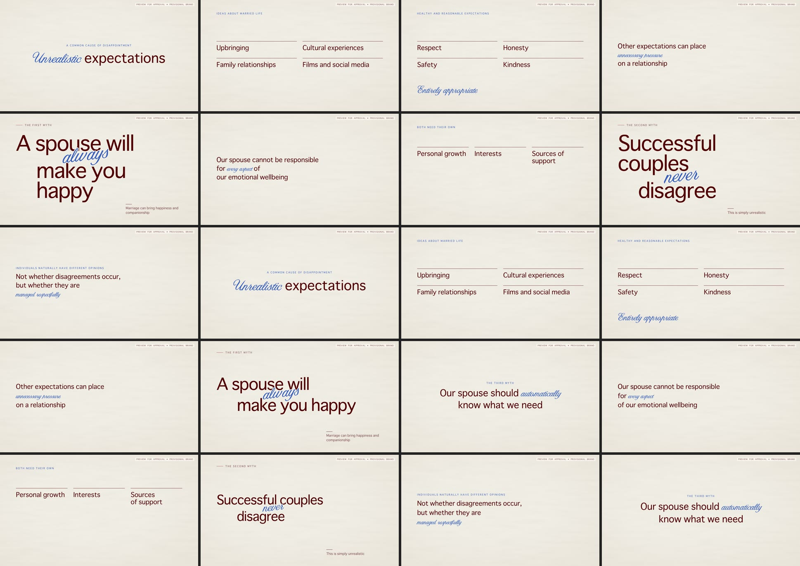

# Storyboard — Module 01: The sacred purpose of marriage

Lesson `lifelink-course-L01` · 36:05.3 · 250 scenes · 16 sections · 16:9

## Creative plan: Module 01, opening (0:00–0:40.7), preview for approval

**Tone:** warm welcome → quiet significance → inclusive → the academy's core belief.

| Scene | Time | Narration (transcript) | Treatment | Why |
|---|---|---|---|---|
| s001 | 0.0–7.6 | "Assalamu Alaikum, welcome to LifeLink Marriage Academy brought to you by Educating Excellence Group." | Course intro (The Folder) | Opening of the whole academy; brand moment |
| s002 | 7.6–16.4 | "…this important first step towards preparing for one of the most significant relationships of your life." | Reflection on royal blue | The weight of the decision; stillness, not spectacle |
| s003 | 16.4–29.0 | "Whether you are considering marriage for the first time, have previously been married or are now exploring the possibility of remarriage, this programme has been developed to support you." | Equal Columns (new) | Three kinds of learner shown as equals: no numbers, no ranking, no dimming |
| s004 | 29.0–40.7 | "At LifeLink we believe that finding the right life partner is important, however we also believe that becoming the right life partner is equally important." | Key statement, script emphasis on *Becoming*, *equally* | The academy's central idea: the shift from finding to becoming |

**Flags for the client:**
- "Educating Excellence Group" is spoken but not shown on screen. Should it appear (e.g. on the intro card)?
- Module title "The sacred purpose of marriage" is taken from the narration at ~2:05 ("In this first module, we will explore the sacred purpose of marriage").
- Transcription needs checking later in the lesson (not in this preview): "Smillah" → Bismillah? "Surah Arghum" → Surah Ar-Rum (30:21)? "a manner of sacred trust" → "an amanah, a sacred trust"?

## Creative plan: Module 01, extension (0:40.7–1:00), preview for approval

**Tone:** the reframe ("not simply… it is about…") → the faith's definition. Text-only throughout: the narration offers nothing meaningful to picture, so no illustration or decorative motion (client rule).

| Scene | Time | Narration (transcript) | Treatment | Why |
|---|---|---|---|---|
| s005 | 40.7–45.1 | "Marriage is not simply about finding someone who meets a list of expectations," | Statement, plain ink type on paper, each line rises as spoken | The "not this" half of the reframe: no script, no object, so the list gets no visual weight; cut sits in the pause after "expectations" |
| s006 | 45.1–54.4 | "it is about developing the knowledge, emotional maturity, understanding and character needed to build a successful relationship." | Equal Columns (as s003), four qualities, closing in script | The "but this" half: four qualities as unranked equals, each appearing on its word; the outcome lands in royal script |
| s007 | 54.4–60.0 | "In Islam, marriage, or nikah, is a sacred covenant." | Still, centred definition card; script emphasis on *sacred covenant* | The faith's definition; nothing to picture, so a clean text card that holds still once complete. Emphasis on the meaning, not on the uncertain term |

**Flags for the client:**
- Spelling of "nikah" (spoken 56.9–57.4 s; transcription confidence 0.51, not yet listened to): please confirm the house spelling (nikah / nikkah / nikāḥ). Shown in plain type until confirmed.
- Display punctuation: "expectations," is shown as "expectations." because the sentence is split across s005/s006; "the" before "knowledge" is dropped so the four qualities read in parallel. No other words changed.

## Scenes

### 175. sec-13-01 · kineticStatement · 25:13.9–25:23.5 (9.6s)

**On screen:** Unrealistic expectations / Unrealistic / A common cause of disappointment  
**Narration:** We now turn to one of the most common causes of disappointment in relationships, unrealistic expectations.

### 176. sec-13-02 · parallelPhrases · 25:23.5–25:35.9 (12.4s)

**On screen:** Ideas about married life / Upbringing / Cultural experiences / Family relationships / Films and social media  
**Narration:** Many people enter marriage with ideas about what married life should look like. These expectations may come from our upbringing, cultural experiences, family relationships, films, or social media.

### 177. sec-13-03 · parallelPhrases · 25:35.9–25:45.2 (9.3s)

**On screen:** Healthy and reasonable expectations / Respect / Honesty / Safety / Kindness / Entirely appropriate  
**Narration:** Some expectations are healthy and reasonable. For example, expecting respect, honesty, safety, and kindness is entirely appropriate.

### 178. sec-13-04 · kineticStatement · 25:45.2–25:53.5 (8.3s)

**On screen:** Other expectations can place / unnecessary pressure / on a relationship / unnecessary / pressure  
**Narration:** However, other expectations can place unnecessary pressure on a relationship. Let us examine some of the myths shown on this slide.

### 179. sec-13-05 · statementCollision · 25:53.5–26:01.4 (7.9s)

**On screen:** The first myth / A spouse will / always / make you happy / Marriage can bring happiness and companionship  
**Narration:** The first is the belief that a spouse will always make you happy. Marriage can bring enormous happiness and companionship.

### 180. sec-13-06 · kineticStatement · 26:01.4–26:07.5 (6.1s)

**On screen:** Our spouse cannot be responsible / for every aspect / of our emotional wellbeing / every / aspect  
**Narration:** However, our spouse cannot be responsible for every aspect of our emotional wellbeing.

### 181. sec-13-07 · parallelPhrases · 26:07.5–26:14.2 (6.7s)

**On screen:** Both need their own / Personal growth / Interests / Sources of support  
**Narration:** Both individuals need to maintain their own personal growth, interests, and sources of support.

### 182. sec-13-08 · statementCollision · 26:14.2–26:21.2 (7.0s)

**On screen:** The second myth / Successful couples / never / disagree / This is simply unrealistic  
**Narration:** The second myth is that successful couples never disagree. This is simply unrealistic

### 183. sec-13-09 · kineticStatement · 26:21.2–26:33.3 (12.1s)

**On screen:** Not whether disagreements occur, / but whether they are / managed respectfully / managed / respectfully / Individuals naturally have different opinions  
**Narration:** through individuals will naturally have different opinions and preferences. The important issue is not whether disagreements occur, but whether they are managed respectfully.

### 184. sec-13-10 · kineticStatement · 26:33.3–26:38.4 (5.1s)

**On screen:** Our spouse should automatically / know what we need / automatically / The third myth  
**Narration:** The third myth is that our spouse should automatically know what we need.

### 185. sec-13-11 · kineticStatement · 26:38.4–26:50.5 (12.1s)

**On screen:** An expectation that was / never communicated. / Healthy relationships require / clear conversations / clear / conversations / Sometimes people become disappointed  
**Narration:** Sometimes people become disappointed because their partner has not recognized an expectation that was never communicated. Healthy relationships require clear conversations.

### 186. sec-13-12 · statementCollision · 26:50.5–26:55.7 (5.2s)

**On screen:** The fourth myth / Love / alone / is enough / Love is important  
**Narration:** The fourth myth is that love alone is enough. Love is important,

### 187. sec-13-13 · parallelPhrases · 26:55.7–27:04.7 (9.0s)

**On screen:** Lasting relationships also require / Trust / Compatibility / Communication / Responsibility / and / effort  
**Narration:** but lasting relationships also require trust, compatibility, communication, responsibility, and effort. Another

### 188. sec-13-14 · kineticStatement · 27:04.7–27:10.2 (5.5s)

**On screen:** Marriage will solve / all our personal problems / all / Another common misconception  
**Narration:** common misconception is that marriage will solve all our personal problems.

### 189. sec-13-15 · parallelPhrases · 27:10.2–27:20.2 (10.0s)

**On screen:** Marriage can support, but cannot automatically resolve / Emotional difficulties / Financial challenges / Unresolved personal issues  
**Narration:** Marriage can provide support, but it cannot automatically resolve emotional difficulties, financial challenges, or unresolved personal issues.

### 190. sec-13-16 · kineticStatement · 27:20.2–27:28.5 (8.3s)

**On screen:** Expecting their spouse / to change completely / change / completely / Finally  
**Narration:** Finally, some individuals enter marriage expecting their spouse to change completely. Although people can grow and develop,

### 191. sec-13-17 · kineticStatement · 27:28.5–27:35.4 (6.9s)

**On screen:** Marriage should not begin / with the assumption that / we can transform another person / into someone entirely different / transform  
**Narration:** marriage should not begin with the assumption that we can transform another person into someone entirely different.

### 192. sec-13-18 · reflectionField · 27:35.4–27:47.9 (12.5s)

**On screen:** Honest conversations / before marriage / so important / Not only what we hope for, / also what we are realistically prepared to contribute / oxblood  
**Narration:** This is why honest conversations before marriage are so important. We need to understand not only what we hope for, also what we are realistically prepared to contribute.
