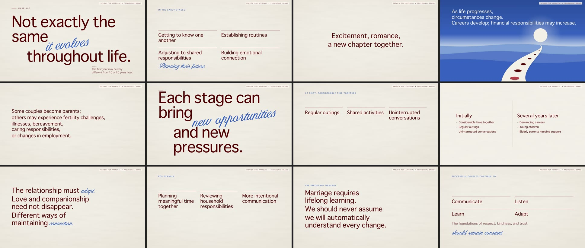

# Storyboard — Module 01: The sacred purpose of marriage

Lesson `lifelink-course-L01` · 36:05.3 · 19 scenes · 3 sections · 16:9

## Creative plan: Module 01, opening (0:00–0:40.7), preview for approval

**Tone:** warm welcome → quiet significance → inclusive → the academy's core belief.

| Scene | Time | Narration (transcript) | Treatment | Why |
|---|---|---|---|---|
| s001 | 0.0–7.6 | "Assalamu Alaikum, welcome to LifeLink Marriage Academy brought to you by Educating Excellence Group." | Course intro (The Folder) | Opening of the whole academy; brand moment |
| s002 | 7.6–16.4 | "…this important first step towards preparing for one of the most significant relationships of your life." | Reflection on royal blue | The weight of the decision; stillness, not spectacle |
| s003 | 16.4–29.0 | "Whether you are considering marriage for the first time, have previously been married or are now exploring the possibility of remarriage, this programme has been developed to support you." | Equal Columns (new) | Three kinds of learner shown as equals: no numbers, no ranking, no dimming |
| s004 | 29.0–40.7 | "At LifeLink we believe that finding the right life partner is important, however we also believe that becoming the right life partner is equally important." | Key statement, script emphasis on *Becoming*, *equally* | The academy's central idea: the shift from finding to becoming |

**Flags for the client:**
- "Educating Excellence Group" is spoken but not shown on screen. Should it appear (e.g. on the intro card)?
- Module title "The sacred purpose of marriage" is taken from the narration at ~2:05 ("In this first module, we will explore the sacred purpose of marriage").
- Transcription needs checking later in the lesson (not in this preview): "Smillah" → Bismillah? "Surah Arghum" → Surah Ar-Rum (30:21)? "a manner of sacred trust" → "an amanah, a sacred trust"?

## Creative plan: Module 01, extension (0:40.7–1:00), preview for approval

**Tone:** the reframe ("not simply… it is about…") → the faith's definition. Text-only throughout: the narration offers nothing meaningful to picture, so no illustration or decorative motion (client rule).

| Scene | Time | Narration (transcript) | Treatment | Why |
|---|---|---|---|---|
| s005 | 40.7–45.1 | "Marriage is not simply about finding someone who meets a list of expectations," | Statement, plain ink type on paper, each line rises as spoken | The "not this" half of the reframe: no script, no object, so the list gets no visual weight; cut sits in the pause after "expectations" |
| s006 | 45.1–54.4 | "it is about developing the knowledge, emotional maturity, understanding and character needed to build a successful relationship." | Equal Columns (as s003), four qualities, closing in script | The "but this" half: four qualities as unranked equals, each appearing on its word; the outcome lands in royal script |
| s007 | 54.4–60.0 | "In Islam, marriage, or nikah, is a sacred covenant." | Still, centred definition card; script emphasis on *sacred covenant* | The faith's definition; nothing to picture, so a clean text card that holds still once complete. Emphasis on the meaning, not on the uncertain term |

**Flags for the client:**
- Spelling of "nikah" (spoken 56.9–57.4 s; transcription confidence 0.51, not yet listened to): please confirm the house spelling (nikah / nikkah / nikāḥ). Shown in plain type until confirmed.
- Display punctuation: "expectations," is shown as "expectations." because the sentence is split across s005/s006; "the" before "knowledge" is dropped so the four qualities read in parallel. No other words changed.

## Scenes

### 8. sec-14-01 · statementCollision · 27:47.9–28:02.9 (15.0s)

**On screen:** Marriage / Not exactly the same / it evolves / throughout life. / The first year may be very different from 10 or 20 years later.  
**Narration:** Marriage is not a relationship that remains exactly the same throughout life. It evolves. The circumstances of a couple during the first year of marriage may be very different from those they experienced 10 or 20 years later.

### 9. sec-14-02 · parallelPhrases · 28:02.9–28:17.3 (14.4s)

**On screen:** In the early stages / Getting to know one another / Establishing routines / Adjusting to shared responsibilities / Building emotional connection / Planning their future  
**Narration:** In the early stages couples may be focused on getting to know one another more deeply. They may be establishing routines, adjusting to shared responsibilities, building emotional connection, and planning their future.

### 10. sec-14-03 · kineticStatement · 28:17.3–28:22.5 (5.2s)

**On screen:** Excitement, romance, / a new chapter together. / new chapter  
**Narration:** There may be excitement, romance, and the experience of beginning a new chapter together.

### 11. sec-14-04 · pathLandscape · 28:22.5–28:30.8 (8.3s)

**On screen:** As life progresses, / circumstances change. / Careers develop; financial responsibilities may increase.  
**Narration:** However, as life progresses, circumstances change. Careers develop, financial responsibilities may increase,

### 12. sec-14-05 · kineticStatement · 28:30.8–28:42.0 (11.2s)

**On screen:** Some couples become parents; / others may experience fertility challenges, / illnesses, bereavement, caring responsibilities, / or changes in employment.  
**Narration:** some couples become parents, others may experience fertility challenges, illnesses, bereavement, caring responsibilities, or changes in employment.

### 13. sec-14-06 · statementCollision · 28:42.0–28:47.0 (5.0s)

**On screen:** Each stage can bring / new opportunities / and new pressures.  
**Narration:** Each stage can bring new opportunities and new pressures.

### 14. sec-14-07 · parallelPhrases · 28:47.0–28:58.7 (11.7s)

**On screen:** At first: considerable time together / Regular outings / Shared activities / Uninterrupted conversations  
**Narration:** Consider a couple who initially have considerable time to spend together. They may enjoy regular outings, shared activities, and uninterrupted conversations.

### 15. sec-14-08 · comparison · 28:58.7–29:09.0 (10.3s)

**On screen:** Initially / Considerable time together / Regular outings / Uninterrupted conversations / Several years later / Demanding careers / Young children / Elderly parents needing support  
**Narration:** Several years later, their circumstances may be very different. They may have demanding careers. Young children are elderly parents who require support.

### 16. sec-14-09 · kineticStatement · 29:09.0–29:22.6 (13.6s)

**On screen:** The relationship must adapt. / Love and companionship need not disappear. / Different ways of maintaining connection. / adapt / connection  
**Narration:** The relationship must adapt to these new realities. This does not mean that love or companionship should disappear. It means that couples may need to find different ways of maintaining their connection.

### 17. sec-14-10 · parallelPhrases · 29:22.6–29:34.0 (11.4s)

**On screen:** For example / Planning meaningful time together / Reviewing household responsibilities / More intentional communication  
**Narration:** For example, spending meaningful time together may require more planning. Household responsibilities may need to be reviewed. Communication may need to become more intentional.

### 18. sec-14-11 · kineticStatement · 29:34.0–29:47.0 (13.0s)

**On screen:** Marriage requires lifelong learning. / We should never assume / we will automatically understand every change. / lifelong learning / The important message  
**Narration:** The important message is that marriage requires lifelong learning. We should never assume that because we understood our spouse at the beginning of the marriage, we will automatically understand every change they experience.

### 19. sec-14-12 · parallelPhrases · 29:47.0–30:00.6 (13.6s)

**On screen:** Successful couples continue to / Communicate / Listen / Learn / Adapt / The foundations of respect, kindness, and trust / should remain constant  
**Narration:** Successful couples continue to communicate, listen, learn, and adapt. The foundations of respect, kindness, and trust should remain constant, even when circumstances change.
