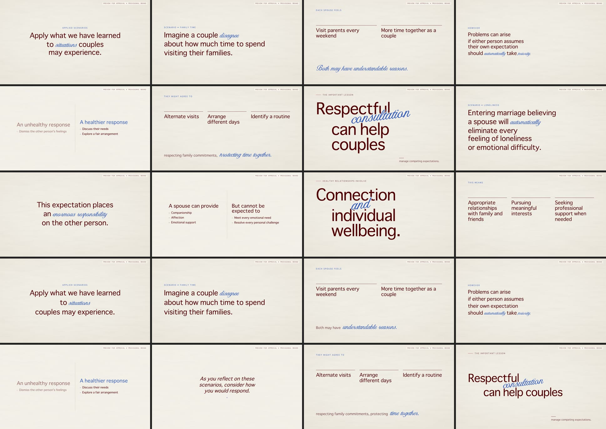

# Storyboard — Module 01: The sacred purpose of marriage

Lesson `lifelink-course-L01` · 36:05.3 · 250 scenes · 16 sections · 16:9

## Creative plan: Module 01, opening (0:00–0:40.7), preview for approval

**Tone:** warm welcome → quiet significance → inclusive → the academy's core belief.

| Scene | Time | Narration (transcript) | Treatment | Why |
|---|---|---|---|---|
| s001 | 0.0–7.6 | "Assalamu Alaikum, welcome to LifeLink Marriage Academy brought to you by Educating Excellence Group." | Course intro (The Folder) | Opening of the whole academy; brand moment |
| s002 | 7.6–16.4 | "…this important first step towards preparing for one of the most significant relationships of your life." | Reflection on royal blue | The weight of the decision; stillness, not spectacle |
| s003 | 16.4–29.0 | "Whether you are considering marriage for the first time, have previously been married or are now exploring the possibility of remarriage, this programme has been developed to support you." | Equal Columns (new) | Three kinds of learner shown as equals: no numbers, no ranking, no dimming |
| s004 | 29.0–40.7 | "At LifeLink we believe that finding the right life partner is important, however we also believe that becoming the right life partner is equally important." | Key statement, script emphasis on *Becoming*, *equally* | The academy's central idea: the shift from finding to becoming |

**Flags for the client:**
- "Educating Excellence Group" is spoken but not shown on screen. Should it appear (e.g. on the intro card)?
- Module title "The sacred purpose of marriage" is taken from the narration at ~2:05 ("In this first module, we will explore the sacred purpose of marriage").
- Transcription needs checking later in the lesson (not in this preview): "Smillah" → Bismillah? "Surah Arghum" → Surah Ar-Rum (30:21)? "a manner of sacred trust" → "an amanah, a sacred trust"?

## Creative plan: Module 01, extension (0:40.7–1:00), preview for approval

**Tone:** the reframe ("not simply… it is about…") → the faith's definition. Text-only throughout: the narration offers nothing meaningful to picture, so no illustration or decorative motion (client rule).

| Scene | Time | Narration (transcript) | Treatment | Why |
|---|---|---|---|---|
| s005 | 40.7–45.1 | "Marriage is not simply about finding someone who meets a list of expectations," | Statement, plain ink type on paper, each line rises as spoken | The "not this" half of the reframe: no script, no object, so the list gets no visual weight; cut sits in the pause after "expectations" |
| s006 | 45.1–54.4 | "it is about developing the knowledge, emotional maturity, understanding and character needed to build a successful relationship." | Equal Columns (as s003), four qualities, closing in script | The "but this" half: four qualities as unranked equals, each appearing on its word; the outcome lands in royal script |
| s007 | 54.4–60.0 | "In Islam, marriage, or nikah, is a sacred covenant." | Still, centred definition card; script emphasis on *sacred covenant* | The faith's definition; nothing to picture, so a clean text card that holds still once complete. Emphasis on the meaning, not on the uncertain term |

**Flags for the client:**
- Spelling of "nikah" (spoken 56.9–57.4 s; transcription confidence 0.51, not yet listened to): please confirm the house spelling (nikah / nikkah / nikāḥ). Shown in plain type until confirmed.
- Display punctuation: "expectations," is shown as "expectations." because the sentence is split across s005/s006; "the" before "knowledge" is dropped so the four qualities read in parallel. No other words changed.

## Scenes

### 205. sec-15-01 · kineticStatement · 30:00.6–30:06.0 (5.4s)

**On screen:** Apply what we have learned / to situations / couples may experience. / situations / Applied scenarios  
**Narration:** Apply what we have learned to situations that couples may experience.

### 206. sec-15-02 · kineticStatement · 30:06.0–30:16.4 (10.4s)

**On screen:** Imagine a couple disagree / about how much time to spend / visiting their families. / disagree / Scenario · Family time  
**Narration:** Our first scenario involves family time. Imagine that a couple disagree about how much time they should spend visiting their respective families.

### 207. sec-15-03 · parallelPhrases · 30:16.4–30:28.9 (12.5s)

**On screen:** Each spouse feels / Visit parents every weekend / More time together as a couple / Both may have / understandable reasons.  
**Narration:** One spouse feels that they should visit their parents every weekend. The other feels that they need more time together as a couple. Both individuals may have understandable reasons for their preferences.

### 208. sec-15-04 · kineticStatement · 30:28.9–30:37.4 (8.5s)

**On screen:** Problems can arise / if either person assumes / their own expectation / should automatically take priority. / automatically / priority. / However  
**Narration:** However, problems can arise if either person assumes that their own expectation should automatically take priority.

### 209. sec-15-05 · comparison · 30:37.4–30:51.6 (14.2s)

**On screen:** An unhealthy response / Dismiss the other person's feelings / A healthier response / Discuss their needs / Explore a fair arrangement  
**Narration:** An unhealthy response would be to dismiss the other person's feelings or make unnatural decisions. A healthier response would involve discussing their needs and exploring a fair arrangement.

### 210. sec-15-06 · parallelPhrases · 30:51.6–31:02.6 (11.0s)

**On screen:** They might agree to / Alternate visits / Arrange different days / Identify a routine / respecting family commitments, protecting / time together.  
**Narration:** They might agree to alternate visits, arrange different days, or identify a routine that respects their family commitments whilst protecting their time together.

### 211. sec-15-07 · statementCollision · 31:02.6–31:10.4 (7.8s)

**On screen:** The important lesson / Respectful / consultation / can help couples / manage competing expectations.  
**Narration:** The important lesson is that respectful consultation can help couples manage competing expectations.

### 212. sec-15-08 · kineticStatement · 31:10.4–31:23.0 (12.6s)

**On screen:** Entering marriage believing / their spouse will automatically / eliminate every / feeling of loneliness / or emotional difficulty. / automatically / Scenario · Loneliness  
**Narration:** Our second scenario involves loneliness. Imagine someone entering marriage with the belief that their spouse will automatically eliminate every feeling of loneliness or emotional difficulty.

### 213. sec-15-09 · kineticStatement · 31:23.0–31:28.4 (5.4s)

**On screen:** This expectation places / an enormous responsibility / on the other person. / enormous / responsibility  
**Narration:** This expectation places an enormous responsibility on the other person.

### 214. sec-15-10 · comparison · 31:28.4–31:39.6 (11.2s)

**On screen:** A spouse can provide / Companionship / Affection / Emotional support / Cannot be expected to / Meet every emotional need / Resolve every personal challenge  
**Narration:** A spouse can provide companionship, affection, and emotional support. However, they cannot be expected to meet every emotional need or resolve every personal challenge.

### 215. sec-15-11 · statementCollision · 31:39.6–31:44.8 (5.2s)

**On screen:** Healthy relationships involve / Connection / and / individual wellbeing.  
**Narration:** Healthy relationships involve both connection and individual wellbeing.

### 216. sec-15-12 · parallelPhrases · 31:44.8–31:54.4 (9.6s)

**On screen:** This means / Relationships with family and friends / Meaningful interests / Professional support when needed  
**Narration:** This means maintaining appropriate relationships with family and friends, pursuing meaningful interests and seeking professional support when needed.

### 217. sec-15-13 · quietReflection · 31:54.4–31:59.4 (5.0s)

**On screen:** As you reflect on these scenarios, consider how you would respond.  
**Narration:** As you reflect on these scenarios, consider how you would respond.

### 218. sec-15-14 · reflectionField · 31:59.4–32:02.7 (3.3s)

**On screen:** Would you be willing to listen / to a different perspective? / oxblood  
**Narration:** Would you be willing to listen to a different perspective?

### 219. sec-15-14b · reflectionField · 32:02.7–32:07.0 (4.3s)

**On screen:** Could you acknowledge that your spouse's needs / may differ from your own? / oxblood  
**Narration:** Could you acknowledge that your spouse's needs may differ from your own?

### 220. sec-15-14c · reflectionField · 32:07.0–32:11.6 (4.6s)

**On screen:** Would you be prepared to compromise / without feeling that you had lost? / oxblood  
**Narration:** Would you be prepared to compromise without feeling that you had lost?

### 221. sec-15-15 · kineticStatement · 32:11.6–32:19.0 (7.4s)

**On screen:** These questions / help us develop / the emotional maturity / required for marriage. / emotional / maturity  
**Narration:** These are the kinds of questions that help us develop the emotional maturity required for marriage.
