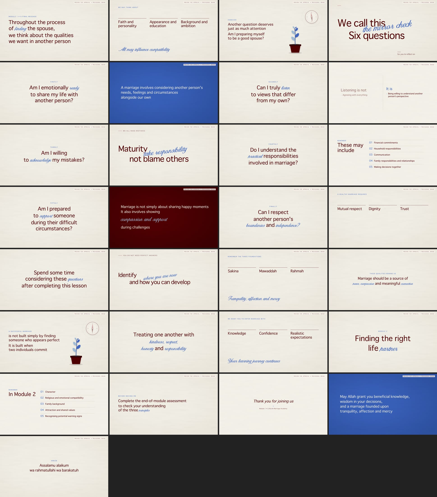

# Storyboard — Module 01: The sacred purpose of marriage

Lesson `lifelink-course-L01` · 36:05.3 · 250 scenes · 16 sections · 16:9

## Creative plan: Module 01, opening (0:00–0:40.7), preview for approval

**Tone:** warm welcome → quiet significance → inclusive → the academy's core belief.

| Scene | Time | Narration (transcript) | Treatment | Why |
|---|---|---|---|---|
| s001 | 0.0–7.6 | "Assalamu Alaikum, welcome to LifeLink Marriage Academy brought to you by Educating Excellence Group." | Course intro (The Folder) | Opening of the whole academy; brand moment |
| s002 | 7.6–16.4 | "…this important first step towards preparing for one of the most significant relationships of your life." | Reflection on royal blue | The weight of the decision; stillness, not spectacle |
| s003 | 16.4–29.0 | "Whether you are considering marriage for the first time, have previously been married or are now exploring the possibility of remarriage, this programme has been developed to support you." | Equal Columns (new) | Three kinds of learner shown as equals: no numbers, no ranking, no dimming |
| s004 | 29.0–40.7 | "At LifeLink we believe that finding the right life partner is important, however we also believe that becoming the right life partner is equally important." | Key statement, script emphasis on *Becoming*, *equally* | The academy's central idea: the shift from finding to becoming |

**Flags for the client:**
- "Educating Excellence Group" is spoken but not shown on screen. Should it appear (e.g. on the intro card)?
- Module title "The sacred purpose of marriage" is taken from the narration at ~2:05 ("In this first module, we will explore the sacred purpose of marriage").
- Transcription needs checking later in the lesson (not in this preview): "Smillah" → Bismillah? "Surah Arghum" → Surah Ar-Rum (30:21)? "a manner of sacred trust" → "an amanah, a sacred trust"?

## Creative plan: Module 01, extension (0:40.7–1:00), preview for approval

**Tone:** the reframe ("not simply… it is about…") → the faith's definition. Text-only throughout: the narration offers nothing meaningful to picture, so no illustration or decorative motion (client rule).

| Scene | Time | Narration (transcript) | Treatment | Why |
|---|---|---|---|---|
| s005 | 40.7–45.1 | "Marriage is not simply about finding someone who meets a list of expectations," | Statement, plain ink type on paper, each line rises as spoken | The "not this" half of the reframe: no script, no object, so the list gets no visual weight; cut sits in the pause after "expectations" |
| s006 | 45.1–54.4 | "it is about developing the knowledge, emotional maturity, understanding and character needed to build a successful relationship." | Equal Columns (as s003), four qualities, closing in script | The "but this" half: four qualities as unranked equals, each appearing on its word; the outcome lands in royal script |
| s007 | 54.4–60.0 | "In Islam, marriage, or nikah, is a sacred covenant." | Still, centred definition card; script emphasis on *sacred covenant* | The faith's definition; nothing to picture, so a clean text card that holds still once complete. Emphasis on the meaning, not on the uncertain term |

**Flags for the client:**
- Spelling of "nikah" (spoken 56.9–57.4 s; transcription confidence 0.51, not yet listened to): please confirm the house spelling (nikah / nikkah / nikāḥ). Shown in plain type until confirmed.
- Display punctuation: "expectations," is shown as "expectations." because the sentence is split across s005/s006; "the" before "knowledge" is dropped so the four qualities read in parallel. No other words changed.

## Scenes

### 222. sec-16-01 · kineticStatement · 32:19.0–32:33.5 (14.5s)

**On screen:** Throughout the process of finding the spouse, / we think about the qualities we want in another person / finding / Module 1 · A final message  
**Narration:** We have now reached the final slide of our first module. I would like to conclude with a very important message. Throughout the process of finding the spouse, we naturally spend time thinking about the qualities we want in another person.

### 223. sec-16-02 · parallelPhrases · 32:33.5–32:45.3 (11.8s)

**On screen:** We may think about / Faith and personality / Appearance and education / Background and ambition / All may influence compatibility  
**Narration:** We may think about their faith, personality, appearance, education, family background, or ambition. These are all matters that may influence compatibility.

### 224. sec-16-03 · findingBecoming · 32:45.3–32:53.9 (8.6s)

**On screen:** However / Another question deserves / just as much attention / Am I preparing myself / to be a good spouse? / preparing myself  
**Narration:** However, there is another question that deserves just as much attention. Am I preparing myself to be a good spouse?

### 225. sec-16-04 · statementCollision · 32:53.9–33:02.0 (8.1s)

**On screen:** We call this / the mirror check / Six questions / for you to reflect on  
**Narration:** This is what we call the mirror check. I would like you to reflect on these six questions.

### 226. sec-16-05 · kineticStatement · 33:02.0–33:07.2 (5.2s)

**On screen:** Am I emotionally ready / to share my life with another person? / ready / Firstly  
**Narration:** Firstly, am I emotionally ready to share my life with another person?

### 227. sec-16-06 · reflectionField · 33:07.2–33:14.9 (7.7s)

**On screen:** A marriage involves considering another person's / needs, feelings and circumstances / alongside our own / royal  
**Narration:** A marriage involves considering another person's needs, feelings, and circumstances alongside our own.

### 228. sec-16-07 · kineticStatement · 33:14.9–33:19.7 (4.8s)

**On screen:** Can I truly listen / to views that differ from my own? / listen / Secondly  
**Narration:** Secondly, can I truly listen to views that differ from my own?

### 229. sec-16-08 · comparison · 33:19.7–33:27.4 (7.7s)

**On screen:** Listening is not / Agreeing with everything / It is / Being willing to understand another person's perspective  
**Narration:** Being a good listener does not mean agreeing with everything. It means being willing to understand another person's perspective.

### 230. sec-16-09 · kineticStatement · 33:27.4–33:30.8 (3.4s)

**On screen:** Am I willing / to acknowledge my mistakes? / acknowledge / Thirdly  
**Narration:** Thirdly, am I willing to acknowledge my mistakes?

### 231. sec-16-10 · statementCollision · 33:30.8–33:38.4 (7.6s)

**On screen:** We all make mistakes / Maturity / take responsibility / not blame others  
**Narration:** We all make mistakes, but emotional maturity requires us to take responsibility rather than automatically blaming others.

### 232. sec-16-11 · kineticStatement · 33:38.4–33:44.3 (5.9s)

**On screen:** Do I understand the practical responsibilities / involved in marriage? / practical / Fourthly  
**Narration:** Fourthly, do I understand the practical responsibilities involved in marriage?

### 233. sec-16-12 · takeaway · 33:44.3–33:54.6 (10.3s)

**On screen:** These may include / Financial commitments / Household responsibilities / Communication / Family responsibilities and relationships / Making decisions together  
**Narration:** These may include financial commitments, household responsibilities, communication, family responsibilities, and relationships and making decisions together.

### 234. sec-16-13 · kineticStatement · 33:54.6–34:00.6 (6.0s)

**On screen:** Am I prepared / to support someone / during their difficult circumstances? / support / Fifthly  
**Narration:** Fifthly, am I prepared to support someone during their difficult circumstances?

### 235. sec-16-14 · reflectionField · 34:00.6–34:08.0 (7.4s)

**On screen:** Marriage is not simply about sharing happy moments / It also involves showing / compassion and support / during challenges / oxblood  
**Narration:** Marriage is not simply about sharing happy moments. It also involves showing compassion and support during challenges.

### 236. sec-16-15 · kineticStatement · 34:08.0–34:14.6 (6.6s)

**On screen:** Can I respect / another person's boundaries and independence? / boundaries / independence / Finally  
**Narration:** Finally, can I respect another person's boundaries and independence?

### 237. sec-16-16 · parallelPhrases · 34:14.6–34:20.3 (5.7s)

**On screen:** A healthy marriage requires / Mutual respect / Dignity / Trust  
**Narration:** A healthy marriage requires mutual respect, dignity, and trust. I encourage

### 238. sec-16-17 · kineticStatement · 34:20.3–34:25.2 (4.9s)

**On screen:** Spend some time considering these questions / after completing this lesson / questions  
**Narration:** you to spend some time considering these questions after completing this lesson.

### 239. sec-16-18 · statementCollision · 34:25.2–34:34.6 (9.4s)

**On screen:** You do not need perfect answers / Identify / where you are now / and how you can develop  
**Narration:** You do not need to have perfect answers. The purpose of reflection is to identify where you are now and how you can continue developing.

### 240. sec-16-19 · parallelPhrases · 34:34.6–34:47.6 (13.0s)

**On screen:** Remember the three foundations / Sakina / Mawaddah / Rahmah / Tranquility, affection and mercy  
**Narration:** As we conclude, remember the three foundations we explored at the beginning of this module. Sakina, Bawada, and Rahma. Tranquility, affection, and mercy.

### 241. sec-16-20 · kineticStatement · 34:47.6–34:54.0 (6.4s)

**On screen:** Marriage should be a source of / peace, compassion and meaningful connection / peace / compassion / connection / These qualities remind us  
**Narration:** These qualities remind us that marriage should be a source of peace, compassion, and meaningful connection.

### 242. sec-16-21 · findingBecoming · 34:54.0–35:02.4 (8.4s)

**On screen:** A successful marriage / is not built simply by finding / someone who appears perfect / It is built when / two individuals commit  
**Narration:** The successful marriage is not built simply by finding someone who appears perfect. It is built when two individuals commit to

### 243. sec-16-22 · kineticStatement · 35:02.4–35:08.3 (5.9s)

**On screen:** Treating one another with / kindness, respect, / honesty and responsibility / kindness / respect / honesty / responsibility  
**Narration:** treating one another with kindness, respect, honesty, and responsibility.

### 244. sec-16-23 · parallelPhrases · 35:08.3–35:20.6 (12.3s)

**On screen:** We want you to enter marriage with / Knowledge / Confidence / Realistic expectations / Your learning journey continues  
**Narration:** At LifeLink, we want you to enter marriage with knowledge, confidence, and realistic expectations. This is why your learning journey continues beyond this first module.

### 245. sec-16-24 · kineticStatement · 35:20.6–35:27.2 (6.6s)

**On screen:** Finding the right / life partner / partner / Module 2  
**Narration:** In module two, we will explore finding the right life partner. We will examine the importance

### 246. sec-16-25 · takeaway · 35:27.2–35:38.4 (11.2s)

**On screen:** In Module 2 / Character / Religious and emotional compatibility / Family background / Attraction and shared values / Recognising potential warning signs  
**Narration:** of character, religious compatibility, emotional compatibility, family background, attraction, shared values, and recognizing potential warning signs.

### 247. sec-16-26 · kineticStatement · 35:38.4–35:46.0 (7.6s)

**On screen:** Complete the end-of-module assessment / to check your understanding of the three principles / principles / Before moving on  
**Narration:** Before moving on, please compete the end of module assessment to check your understanding of the three principles we have explored.

### 248. sec-16-27 · quietReflection · 35:46.0–35:50.6 (4.6s)

**On screen:** Thank you for joining us / Module 1 · LifeLink Marriage Academy  
**Narration:** Thank you for joining us for module one of the LifeLink Marriage Academy.

### 249. sec-16-28 · reflectionField · 35:50.6–35:59.6 (9.0s)

**On screen:** May Allah grant you beneficial knowledge, / wisdom in your decisions, / and a marriage founded upon / tranquility, affection and mercy / royal  
**Narration:** May Allah grant you beneficial knowledge, wisdom in your decisions, and a marriage founded upon tranquility, affection, and mercy.

### 250. sec-16-29 · kineticStatement · 35:59.6–36:05.3 (5.7s)

**On screen:** Assalamu alaikum / wa rahmatullahi wa barakatuh / Ameen  
**Narration:** Ameen. Salaamu 'alaykum. Warahmatullahi warahmatullahi wabarakatuh.
