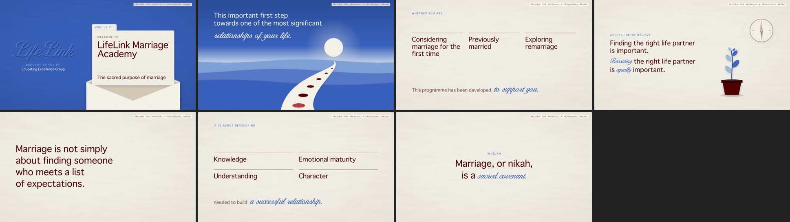

# Storyboard — Module 01: The sacred purpose of marriage

Lesson `lifelink-course-L01` · 36:05.3 · 7 scenes · 2 sections · 16:9

## Creative plan: Module 01, opening (0:00–0:40.7), preview for approval

**Tone:** warm welcome → quiet significance → inclusive → the academy's core belief.

| Scene | Time | Narration (transcript) | Treatment | Why |
|---|---|---|---|---|
| s001 | 0.0–7.6 | "Assalamu Alaikum, welcome to LifeLink Marriage Academy brought to you by Educating Excellence Group." | Course intro (The Folder) | Opening of the whole academy; brand moment |
| s002 | 7.6–16.4 | "…this important first step towards preparing for one of the most significant relationships of your life." | Reflection on royal blue | The weight of the decision; stillness, not spectacle |
| s003 | 16.4–29.0 | "Whether you are considering marriage for the first time, have previously been married or are now exploring the possibility of remarriage, this programme has been developed to support you." | Equal Columns (new) | Three kinds of learner shown as equals: no numbers, no ranking, no dimming |
| s004 | 29.0–40.7 | "At LifeLink we believe that finding the right life partner is important, however we also believe that becoming the right life partner is equally important." | Key statement, script emphasis on *Becoming*, *equally* | The academy's central idea: the shift from finding to becoming |

**Flags for the client:**
- "Educating Excellence Group" is spoken but not shown on screen. Should it appear (e.g. on the intro card)?
- Module title "The sacred purpose of marriage" is taken from the narration at ~2:05 ("In this first module, we will explore the sacred purpose of marriage").
- Transcription needs checking later in the lesson (not in this preview): "Smillah" → Bismillah? "Surah Arghum" → Surah Ar-Rum (30:21)? "a manner of sacred trust" → "an amanah, a sacred trust"?

## Creative plan: Module 01, extension (0:40.7–1:00), preview for approval

**Tone:** the reframe ("not simply… it is about…") → the faith's definition. Text-only throughout: the narration offers nothing meaningful to picture, so no illustration or decorative motion (client rule).

| Scene | Time | Narration (transcript) | Treatment | Why |
|---|---|---|---|---|
| s005 | 40.7–45.1 | "Marriage is not simply about finding someone who meets a list of expectations," | Statement, plain ink type on paper, each line rises as spoken | The "not this" half of the reframe: no script, no object, so the list gets no visual weight; cut sits in the pause after "expectations" |
| s006 | 45.1–54.4 | "it is about developing the knowledge, emotional maturity, understanding and character needed to build a successful relationship." | Equal Columns (as s003), four qualities, closing in script | The "but this" half: four qualities as unranked equals, each appearing on its word; the outcome lands in royal script |
| s007 | 54.4–60.0 | "In Islam, marriage, or nikah, is a sacred covenant." | Still, centred definition card; script emphasis on *sacred covenant* | The faith's definition; nothing to picture, so a clean text card that holds still once complete. Emphasis on the meaning, not on the uncertain term |

**Flags for the client:**
- Spelling of "nikah" (spoken 56.9–57.4 s; transcription confidence 0.51, not yet listened to): please confirm the house spelling (nikah / nikkah / nikāḥ). Shown in plain type until confirmed.
- Display punctuation: "expectations," is shown as "expectations." because the sentence is split across s005/s006; "the" before "knowledge" is dropped so the four qualities read in parallel. No other words changed.

## Scenes

### 1. s001 · courseIntro · 0:00.0–0:07.6 (7.6s)

**On screen:** Welcome to / LifeLink Marriage Academy / Module 01 / The sacred purpose of marriage / Brought to you by Educating Excellence Group  
**Narration:** Assalamu Alaikum, welcome to LifeLink Marriage Academy brought to you by Educating Excellence Group.

### 2. s002 · pathLandscape · 0:07.6–0:16.4 (8.8s)

**On screen:** This important first step / towards one of the most significant / relationships of your life.  
**Narration:** We are delighted that you have taken this important first step towards preparing for one of the most significant relationships of your life.

### 3. s003 · parallelPhrases · 0:16.4–0:29.0 (12.6s)

**On screen:** Whether you are / Considering marriage for the first time / Previously married / Exploring remarriage / This programme has been developed / to support you.  
**Narration:** Whether you are considering marriage for the first time, have previously been married or are now exploring the possibility of remarriage, this programme has been developed to support you.

### 4. s004 · findingBecoming · 0:29.0–0:40.7 (11.7s)

**On screen:** At LifeLink we believe / Finding the right life partner / is important. / Becoming the right life partner / is equally important. / Becoming / equally  
**Narration:** At LifeLink we believe that finding the right life partner is important, however we also believe that becoming the right life partner is equally important.

### 5. s005 · kineticStatement · 0:40.7–0:45.3 (4.6s)

**On screen:** Marriage is not simply / about finding someone / who meets a list / of expectations.  
**Narration:** Marriage is not simply about finding someone who meets a list of expectations,

### 6. s006 · parallelPhrases · 0:45.3–0:54.4 (9.1s)

**On screen:** It is about developing / Knowledge / Emotional maturity / Understanding / Character / needed to build / a successful relationship.  
**Narration:** it is about developing the knowledge, emotional maturity, understanding and character needed to build a successful relationship.

### 7. s007 · kineticStatement · 0:54.4–1:00.0 (5.6s)

**On screen:** Marriage, or nikah, / is a sacred covenant. / sacred / covenant / In Islam  
**Narration:** In Islam, marriage, or nikah, is a sacred covenant.
