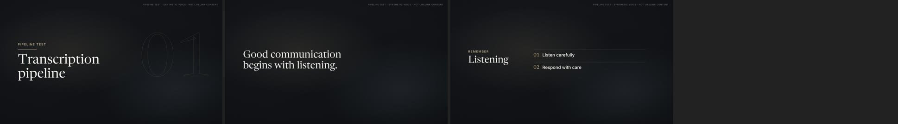

# Storyboard — Pipeline test one

Lesson `pipeline-test-L01` · 0:11.4 · 3 scenes · 1 sections · 16:9

_No creative-plan.md yet._

## Scenes

### 1. s01 · sectionTitle · 0:00.0–0:03.4 (3.4s)

**On screen:** Transcription pipeline / Pipeline test  
**Narration:** This is a technical test of the transcription pipeline.

### 2. s02 · kineticStatement · 0:03.4–0:06.3 (2.9s)

**On screen:** Good communication begins with listening. / listening.  
**Narration:** Good communication begins with listening.

### 3. s03 · takeaway · 0:06.3–0:11.4 (5.1s)

**On screen:** Listening / Listen carefully / Respond with care  
**Narration:** When we listen carefully, we understand more and we respond with care.
