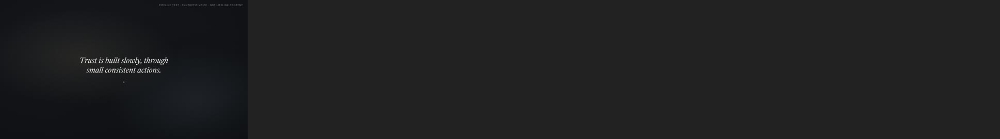

# Storyboard — Pipeline test two

Lesson `pipeline-test-L02` · 0:05.6 · 1 scenes · 1 sections · 16:9

_No creative-plan.md yet._

## Scenes

### 1. s01 · quietReflection · 0:00.0–0:05.6 (5.6s)

**On screen:** Trust is built slowly, through small consistent actions.  
**Narration:** Second test recording. Trust is built slowly through small consistent actions.
